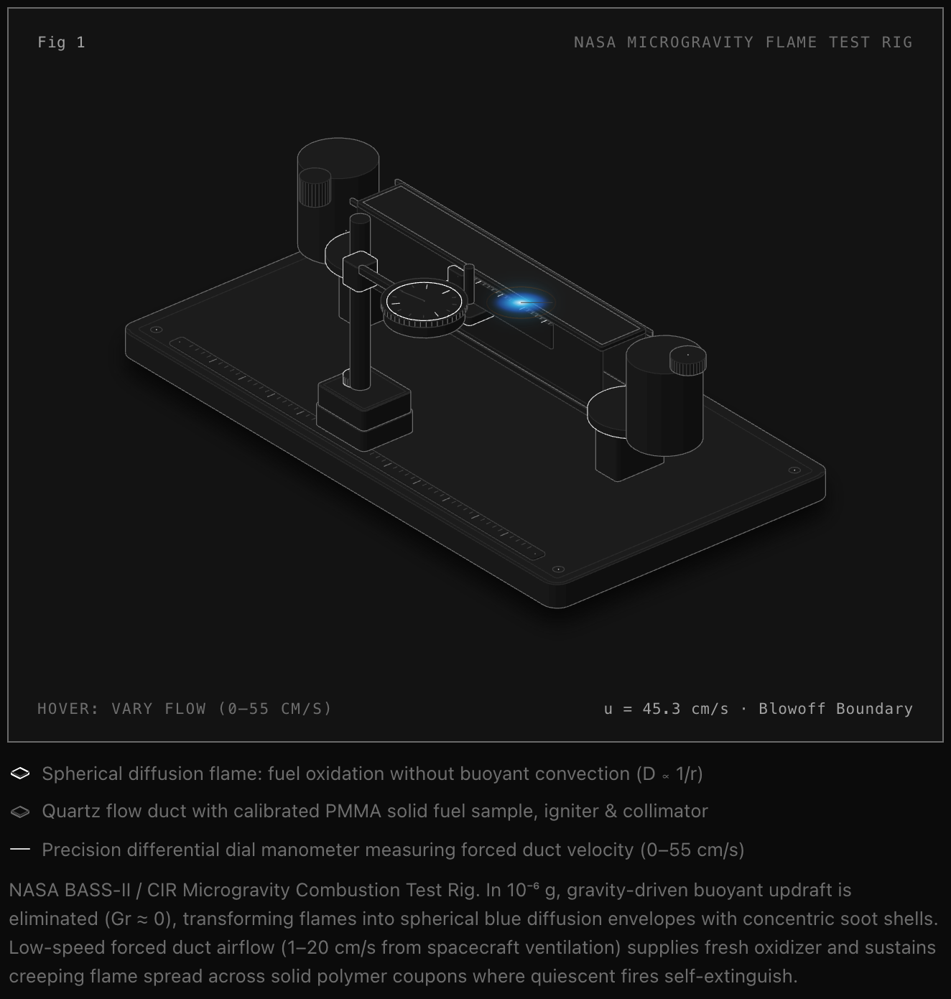

<div align="center">

# 🛰️ GODEYE // PYRO-SI
### Spacecraft Microgravity Combustion Physics & Extraterrestrial Habitat Fire Safety Intelligence
**NASA Space Apps Challenge 2026 · Global Finalist Project · Theme: _Flame in Freefall_**

---

[](backend/api/main.py)
[](backend/intelligence/nasa_rag.py)
[-brightgreen?style=flat&logo=javascript&logoColor=white)](tests/test-runner.js)
[-brightgreen?style=flat&logo=python&logoColor=white)](tests/run_backend_tests.py)
[](docs/DATASET_CATALOG.md)
[](docs/SCIENTIFIC_VALIDATION.md)
[](docs/ARCHITECTURE.md)

<br/>

<a href="#-executive-summary">Executive Summary</a> •
<a href="#-technical-figures--apparatus">Technical Apparatus</a> •
<a href="#-scientific-capabilities">Core Modules</a> •
<a href="#-mathematical-formulation--physics">Physics & Math</a> •
<a href="#-system-architecture">Architecture</a> •
<a href="#-verification--test-gates">Verification</a> •
<a href="#-quick-start--flight-readiness">Quick Start</a> •
<a href="#-authoritative-documentation">Documentation</a>

<br/>

---

### NASA Microgravity Combustion & Flame Spread Test Apparatus
*Isometric Engineering Model of ISS CIR / Microgravity Science Glovebox BASS-II Hardware*

<br/>



<br/>

**[🔬 Launch Interactive 3D/2D Rig Figure (Dark Theme)](docs/figures/combustion-rig/combustion-rig.html)** &nbsp;•&nbsp; **[☀️ Launch Interactive Rig Figure (Light Theme)](docs/figures/combustion-rig/combustion-rig-light.html)**

---

</div>

<br/>

## 📋 Executive Summary

**GODEYE // PYRO-SI** is an authoritative aerospace intelligence system engineered for the **NASA Space Apps Challenge 2026 (_Flame in Freefall_)**. The platform bridges fundamental physical science research archived in the **NASA Physical Sciences Informatics (PSI)** repository with operational fire safety engineering for long-duration crewed spaceflight and extraterrestrial planetary outposts:
* **International Space Station (ISS)** in Low Earth Orbit ($\mu\text{g}$)
* **Gateway Station** in Lunar Near-Rectilinear Halo Orbit (NRHO)
* **Artemis Lunar Base Camp** on the lunar South Pole ($0.16\text{ g}$)
* **Mars Surface Habitats** ($0.38\text{ g}$)

### The Fundamental Problem: Flame in Freefall
Combustion in orbital freefall defies terrestrial intuition. On Earth ($1\text{ g}$), gravity drives strong buoyant convection: hot, low-density combustion products rise, drawing in fresh oxygen and shaping flames into familiar teardrops. In microgravity ($\approx 10^{-6}\text{ g}$), the Grashof number collapses ($Gr \approx 0$):
* **No Buoyant Updraft:** Buoyancy-driven natural convection vanishes entirely.
* **Diffusion Dominated Transport:** Oxidizer flux and fuel vapor transport are governed strictly by radial molecular diffusion ($D \propto 1/r$).
* **Quiescent Extinction vs. Airflow Hazard:** Quiescent fires often choke on their own combustion products; however, forced cabin air circulation ($0.01\text{ to }0.55\text{ m/s}$ from environmental control and life support systems, ECLSS) supplies continuous oxygen, driving steady, non-buoyant creeping flame spread.
* **Invisible Cool Flames:** Hydrocarbon droplet combustion reveals low-temperature (500–800 K) chemical kinetics that burn invisibly long after visible chemiluminescence self-extinguishes (NASA FLEX experiment).
* **The Partial-Gravity Flammability Peak:** At lunar partial gravity ($0.16\text{ g}$), combined with proposed Exploration Atmospheres (34% $\text{O}_2$, $56.5\text{ kPa}$ / $8.2\text{ psia}$), reduced buoyancy limits convective cooling while still clearing products, resulting in flame spread rates exceeding terrestrial $1\text{ g}$ baselines (*T'ien & Ferkul low-buoyancy theory*).

PYRO-SI equips payload developers, mission flight controllers, and habitat designers with a deterministic, mathematically grounded dashboard that visualizes, calculates, and reasons across 19 authentic NASA combustion flight investigations.

---

## 🌍 Extraterrestrial Habitat Flammability Matrix

| Operational Regime | Gravitational Acceleration ($g$) | Total Pressure ($P$) | Oxygen Conc. ($X_{O_2}$) | Buoyancy Regime ($Gr$) | Primary Flame Behavior & Hazard Profile |
|:---|:---:|:---:|:---:|:---:|:---|
| **Terrestrial Standard (Earth 1g)** | $1.0\text{ g}$ | $101.3\text{ kPa}$ ($14.7\text{ psia}$) | $20.9\%\text{ O}_2$ | $Gr \sim 10^5$ (Turbulent/Laminar Buoyant) | Vigorous upward buoyant flickering teardrop; soot clearance via thermal plume; high convective cooling. |
| **ISS Nominal Cabin (Low Earth Orbit)** | $\approx 10^{-6}\text{ g}$ | $101.3\text{ kPa}$ ($14.7\text{ psia}$) | $21.0\%\text{ O}_2$ | $Gr \approx 0$ (Buoyancy Suppressed) | Quiescent spherical blue chemiluminescent shell; soot trapped in spherical shells; sustained only by ventilation ($1\text{--}20\text{ cm/s}$). |
| **Lunar Base Camp (Artemis EAM)** | $0.166\text{ g}$ | $56.5\text{ kPa}$ ($8.2\text{ psia}$) | $34.0\%\text{ O}_2$ | $Gr \sim 10^3$ (Low Buoyancy / Peak Hazard) | **Critical Hazard Band:** Diminished convective cooling allows maximum heat feedback; materials self-extinguishing at 1g burn vigorously. |
| **Mars Habitat Nominal** | $0.38\text{ g}$ | $65.5\text{ kPa}$ ($9.5\text{ psia}$) | $28.0\%\text{ O}_2$ | $Gr \sim 10^4$ (Transitional Sub-Buoyant) | Elongated dome flame; intermediate buoyancy; enhanced flame spread on vertical fabric geometries. |
| **Depressurized Airlock Egress** | Variable | $34.5\text{ kPa}$ ($5.0\text{ psia}$) | $100.0\%\text{ O}_2$ | Pressure-Suppressed | **Extreme Fire Hazard:** Pure oxygen environment; hyper-accelerated solid polymer pyrolysis (Apollo 1 condition). |

---

## 🔬 Technical Figures & Apparatus

The isometric technical model embedded above highlights the core experimental architecture of NASA's microgravity combustion rigs (such as the **Microgravity Science Glovebox BASS-II** and the **Combustion Integrated Rack ACME**):

```
+-------------------------------------------------------------------------+
|                  NASA COMBUSTION FLOW APPARATUS (BASS-II)               |
+-------------------------------------------------------------------------+
      [Airflow Blower / Screen]  --->  [Flow Straightening Section]
                                                   |
                                                   v
   +-------------------------------------------------------------------+
   |  [High-Speed Color Optical Imager]     [Radiometer Array (Ch1-Ch4)]|
   |                                                                   |
   |    ====> Duct Flow (0 - 55 cm/s) ====>                            |
   |                                                                   |
   |            +-------------------------------+                      |
   |   (Spark)  |  Solid Fuel Sample (PMMA/SIBAL)|                      |
   |   Igniter  +-------------------------------+                      |
   |                                                                   |
   |  [Optical Observation Window]          [Duct Exhaust & Particle Traps]|
   +-------------------------------------------------------------------+
                                                   |
                                                   v
                           [Mass Flow Sensor & CSA-CP/CDM Sampling]
```

Interactive, hardware-accelerated SVG/HTML versions of this figure are included in the repository:
- **Dark HUD Presentation:** [`docs/figures/combustion-rig/combustion-rig.html`](docs/figures/combustion-rig/combustion-rig.html)
- **Light Document Presentation:** [`docs/figures/combustion-rig/combustion-rig-light.html`](docs/figures/combustion-rig/combustion-rig-light.html)
- **Procedural Script:** Built using the zero-dependency isometric anatomy kit in [`docs/figures/combustion-rig/build.mjs`](docs/figures/combustion-rig/build.mjs).

---

## ⚡ Primary Flight Intelligence Capabilities

### 1. GODEYE 3D Orbital & Tactical Ephemeris
- Real-time 3D orbital mechanization rendering the **International Space Station** ground track, orbit vector, and position relative to solar terminator.
- Cislunar trajectory visualization targeting the **Artemis Lunar Gateway** in Near-Rectilinear Halo Orbit (NRHO).
- Interactive habitat selector cross-referencing environmental pressure, diluent gas composition, and gravity level.

### 2. High-Fidelity 2D Combustion Chamber
- Multi-regime real-time particle dynamics engine simulating four distinct physical combustion regimes:
  1. **Zero-G Spherical Diffusion Flame:** Blue chemiluminescent spherical reaction front, soot formation trapped by thermophoresis, radial diffusion boundary layer.
  2. **Lunar 0.16g Low-Buoyancy Plume:** Broad, slow-moving convective dome with extended flame height and enhanced solid surface pyrolyzation.
  3. **ACME Inside-Out Coflow Burner:** Annular gas diffusion flame modeling porous spherical burner dynamics.
  4. **Earth 1g Reference Teardrop:** High-frequency buoyant flickering driven by Rayleigh-Taylor plume instabilities.

### 3. NASA PSI Multi-Criteria Investigation Matrix & Comparator
- Live catalog of **19 authentic NASA combustion flight investigations** with verified accession identifiers (e.g., PSI-25 BASS-II, PSI-98 Saffire-I, PSI-69 FLEX, PSI-10 ACME).
- Deterministic 4-slider multi-criteria decision model allowing flight safety engineers to weight:
  - **Material Ignition Prevention**
  - **Flame Spread Suppression**
  - **Aerosol & Smoke Detection**
  - **Partial Gravity Dynamics**
- Transparent scoring formula with explicit epistemic certainty disclosures and **missing evidence warnings** (e.g., highlighting when an investigation lacks embedded solid-sample thermocouples).
- Non-destructive 3-way investigation comparator that never mutates user selections during background recalculation.

### 4. Predictive Flammability & Environmental Bounding Simulator
- Implements the theoretical **T'ien & Ferkul low-buoyancy combustion model** to evaluate flame spread velocity across $0\text{ to }1\text{ g}$.
- Real-time calculation of oxygen partial pressure ($p_{O_2}$ in $\text{psia}$ and $\text{kPa}$) via Dalton's Law.
- Verification against **NASA-STD-3001 Rev F ([V2 6003])** normoxia band ($145\text{--}155\text{ mmHg}$) and minimum 30% diluent requirement ([V2 6002]).
- Evaluates material-specific Limiting Oxygen Index ($LOI$) shifts under quiescent vs. forced convective regimes.

### 5. Evidence-Grounded Research Co-Pilot (Gemini RAG)
- Specialized conversational intelligence for NASA combustion science and spacecraft fire safety.
- **Dual-Tier Query Handling:**
  - Fast, deterministic offline knowledge engine for zero-network environments.
  - Live Gemini 3 Flash / 2.0 Flash generative synthesis backed by indexed NASA PSI flight records.
- **BYOK (Bring Your Own Key) Security Gateway:** Secure credential handling with client-side masking and zero disk/localStorage secret persistence.
- **Evidence Dossier Cards:** Structured outputs with verified citations, DOI URLs, epistemic provenance badges, and experimental parameter summaries.
- Strict scope enforcement: Rejects non-aerospace queries (e.g., general software coding, pop culture) and admits evidence boundaries honestly.

### 6. Incident Retrospective & Terrestrial Tech Transfer
- Deep technical breakdowns of historical spacecraft fire emergencies:
  - **Apollo 1 (1967):** High-pressure pure oxygen ($16.7\text{ psia}$, $100\%\text{ O}_2$) catastrophic flashover.
  - **Apollo 13 (1970):** Supercritical cryogenic oxygen tank combustion and thermomechanical rupture.
  - **Mir Space Station (1997):** Solid-fuel oxygen generator (Vika candle) uncontrolled fire in microgravity.
- Traceable links to terrestrial spinoff technologies:
  - **Fine Water-Mist Fire Suppression:** Halon-replacement volumetric quenching developed for ISS.
  - **SAME-R / DAFT Dust-Discriminative Detectors:** Aerosol physics preventing nuisance false alarms in mining and space habitats.

---

## 📐 Mathematical Formulation & Physics

### 1. Grashof Number (Buoyancy Criterion)
$$\text{Gr} = \frac{g \beta (T_f - T_\infty) L^3}{\nu^2}$$
*Where:*
- $g$: Local gravitational acceleration ($\text{m/s}^2$). In orbit, $g \approx 10^{-6}\text{ g} \implies \text{Gr} \approx 0$.
- $\beta$: Volumetric thermal expansion coefficient ($\approx 1/T_\infty$ for ideal gas, $\text{K}^{-1}$).
- $T_f, T_\infty$: Flame temperature and ambient gas temperature ($\text{K}$).
- $L$: Characteristic length scale ($\text{m}$).
- $\nu$: Kinematic viscosity of the oxidizer mixture ($\text{m}^2/\text{s}$).

### 2. Natural Convection Buoyant Velocity Scale
$$u_b = \sqrt{2 g L \left(\frac{T_f - T_\infty}{T_\infty}\right)}$$
When $g \to 0$, $u_b \to 0$, and the effective velocity field $u_{\text{eff}}$ across solid fuel samples simplifies strictly to the forced ventilation flow from cabin ventilation:
$$u_{\text{eff}} = \sqrt{u_b^2 + u_{\text{forced}}^2}$$

### 3. Dalton's Law of Partial Pressures
$$p_{O_2} = X_{O_2} \cdot P_{\text{total}}$$
Normoxia band defined by NASA-STD-3001 Rev F:
$$19.33\text{ kPa} \le p_{O_2} \le 20.66\text{ kPa} \quad (145\text{--}155\text{ mmHg})$$

### 4. T'ien & Ferkul Low-Buoyancy Flame Spread Peak
The flame spread rate $V_f$ across thin solid fuels in low-velocity concurrent or opposed flow exhibits a distinct maximum at partial gravity ($0.05\text{--}0.25\text{ g}$):
$$V_f \propto \frac{\lambda_g (T_f - T_{\text{ign}})}{\rho_s c_s \tau (T_{\text{ign}} - T_0)} \cdot \Phi(u_{\text{eff}}, X_{O_2})$$
Because moderate buoyancy removes combustion products without exerting the severe convective blow-off cooling of $1\text{ g}$, the flame temperature $T_f$ reaches local maxima at lunar gravity ($0.16\text{ g}$).

### 5. Multi-Criteria Ranking Formulation
$$\text{Score}_i = \sum_{k=1}^{4} \left( w_k \cdot \mu_{i,k} \cdot \gamma_{i,k} \right) \cdot \Omega_{\text{epistemic}}$$
*Where:*
- $w_k$: Normalized user slider priority weight ($\sum w_k = 1.0$).
- $\mu_{i,k}$: Base capability rating of investigation $i$ in domain $k$.
- $\gamma_{i,k}$: Completeness coefficient ($\gamma = 1.0$ for complete evidence, $\gamma < 0.7$ for missing variables).
- $\Omega_{\text{epistemic}}$: Epistemic weight factor ($1.0$ for verified flight data, $0.85$ for extracted video measurements, $0.70$ for unverified ground baselines).

---

## 🏛️ System Architecture

PYRO-SI is architected with a strict separation between client-side deterministic physics evaluation and backend generative intelligence:

```
+-----------------------------------------------------------------------------------------+
|                                    CLIENT BROWSER (EDGE)                                |
|                                                                                         |
|  +-----------------------+   +------------------------+   +--------------------------+  |
|  |  GODEYE Orbital Globe |   |  2D Combustion Chamber |   |  Flammability Simulator  |  |
|  |  (Cesium / Three.js)  |   |  (HTML5 Canvas μg Sim) |   |  (T'ien Low-g Bounding)  |  |
|  +-----------------------+   +------------------------+   +--------------------------+  |
|                                                                                         |
|  +-----------------------------------------------------------------------------------+  |
|  |                     PSI Investigation Matrix & 4-Slider Ranker                    |  |
|  |                     (Deterministic JavaScript Scoring Engine)                     |  |
|  +-----------------------------------------------------------------------------------+  |
|                                           |                                             |
|                             Native Fetch  |  REST API (/api/v1)                         |
|                                           v                                             |
+-----------------------------------------------------------------------------------------+
                                            |
                                            v
+-----------------------------------------------------------------------------------------+
|                            FASTAPI SCIENTIFIC GATEWAY (PORT 8000)                       |
|                                                                                         |
|  +-----------------------------+               +-------------------------------------+  |
|  |  Dynamic Session Tokenizer  |               |  Reverse Proxy & Rate Limiter       |  |
|  |  (Anonymous Lease Contract) |               |  (Token Bucket / 60s Cool-off)      |  |
|  +-----------------------------+               +-------------------------------------+  |
|                 |                                                 |                     |
|                 v                                                 v                     |
|  +-----------------------------------------------------------------------------------+  |
|  |                       NASA PSI RAG RETRIEVAL ENGINE                               |  |
|  |   - In-Memory Inverted Index of 19 Combustion Flight Investigations               |  |
|  |   - Epistemic Metadata Classifier (Measured vs Derived vs Extracted)              |  |
|  |   - NASA Standard Reference Vault (NASA-STD-3001, 6001B, FM2)                    |  |
|  +-----------------------------------------------------------------------------------+  |
|                                           |                                             |
|                                           v                                             |
|  +-----------------------------------------------------------------------------------+  |
|  |                      GOOGLE GEMINI GENERATIVE SYNTHESIS                           |  |
|  |   - Models: gemini-3-flash-preview / gemini-2.0-flash                             |  |
|  |   - Grounded RAG Prompting with Source Attribution & Epistemic Disclosures        |  |
|  |   - Bring-Your-Own-Key (BYOK) Ephemeral Vault                                     |  |
|  +-----------------------------------------------------------------------------------+  |
+-----------------------------------------------------------------------------------------+
```

### Key Architectural Tenets:
1. **Zero-Build Vanilla ESM:** The frontend requires no Webpack, Vite, or Babel bundlers. Native ES Modules run directly in any standards-compliant browser.
2. **Decoupled Gateway:** The FastAPI backend serves as an authenticated proxy and RAG engine. If the backend is offline, the frontend seamlessly degrades to its internal deterministic knowledge engine.
3. **Zero Secret Leakage:** Gemini API keys are entered via a secure client modal, validated over an encrypted HTTPS/REST endpoint, and kept in backend memory leases. Keys are never logged, committed, or written to browser `localStorage`.

---

## 🧪 Verification & Test Gates

Every mathematical model, scoring algorithm, API contract, and boundary condition in PYRO-SI is guarded by automated test suites:

### 1. Frontend & Scientific Test Suite (`npm test`)
- **Location:** [`tests/test-runner.js`](tests/test-runner.js)
- **Status:** **978 passed, 0 failed (100% green)**
- **Coverage:**
  - `[1/17]` Flammability physics model unit tests (Dalton's law, buoyant velocity collapse at 0g, LOI lower bounds).
  - `[2/17]` PSI investigation ranker (4-slider normalization, missing evidence penalties, comparator isolation).
  - `[3/17]` Partial-gravity bounding curves ($0.16\text{ g}$ peak flame spread verification).
  - `[4/17]` Scientific equation boundary constraints ($Gr = 0$, $u_{\text{eff}} = u_{\text{forced}}$, Nomex extinction limits).
  - `[5/17]` Unit conversion & thermodynamic tests ($\text{psi} \leftrightarrow \text{kPa}$, inspired $P_{IO_2}$).
  - `[6/17]` Limiting Oxygen Index (LOI) non-linear regressions.
  - `[7/17]` Habitat atmosphere safety thresholds (Apollo, ISS, Artemis, Mars).
  - `[8/17]` Epistemic data classification schemas.
  - `[9-17/17]` Intent-aware Research Co-Pilot queries, greetings, comparison logic, and out-of-scope boundaries.

### 2. Python Backend & RAG Test Suite (`python3 tests/run_backend_tests.py`)
- **Location:** [`tests/run_backend_tests.py`](tests/run_backend_tests.py)
- **Status:** **71 passed, 0 failed (100% green)**
- **Coverage:**
  - `test_copilot_rag.py`: Natural language RAG retrieval, Gemini prompt formulation, grounding verifications.
  - `test_proxy_endpoint.py`: Anonymous session leasing, upstream rate-limiting, zero-secret-leakage verification.
  - `test_catalogue_reconciliation.py`: File-level vs. study-level epistemic classification, volume accounting.
  - `test_catalogue_integration.py`: Ingestion normalization, duplicate rejection, raw SHA-256 payload preservation.
  - `test_psi_discovery.py`: Elasticsearch query construction, S3 public asset URL generation.

---

## 🚀 Quick Start & Flight Readiness

### Prerequisites
- Modern Web Browser (Chrome, Safari, Firefox, or Edge) with ECMAScript Modules enabled.
- **Node.js** (v18+) *or* **Python** (v3.10+) for local serving.

### Step 1: Clone Repository
```bash
git clone https://github.com/Vellorpavan/PYRO-SI.git
cd PYRO-SI
```

### Step 2: Start the FastAPI Scientific Gateway
```bash
# Optional: create virtual environment
python3 -m venv venv
source venv/bin/activate

# Install gateway dependencies
pip install fastapi uvicorn httpx pydantic

# Launch the gateway on port 8000
python3 -m uvicorn backend.api.main:app --host 0.0.0.0 --port 8000 --reload
```
*The gateway will initialize and listen on `http://127.0.0.1:8000` (API documentation available at `/docs`).*

### Step 3: Serve the Frontend Application
In a separate terminal window:
```bash
# Option A: Node serve (recommended)
npx serve -l 3000 .

# Option B: Python built-in server
python3 -m http.server 3000
```
Open your browser and navigate to **`http://localhost:3000`**.

### Step 4: Run the Complete Verification Suite
```bash
# Run JavaScript Scientific & Physics Test Suite (978 tests)
npm test

# Run Python Backend & RAG Verification Suite (71 tests)
python3 tests/run_backend_tests.py
```

### Step 5: (Optional) Connect Gemini API Key
1. Click the **"Gemini Key"** or status indicator badge in the top right of the Research Co-Pilot interface.
2. Enter your Google AI Studio API key (`AIzaSy...`).
3. The gateway securely validates the key with a low-cost test request. Once verified, live generative flight synthesis is active.

---

## 📚 Authoritative Documentation

All engineering specifications, physical validation logs, and catalogs are indexed below:

| Specification Document | Scope & Contents |
|:---|:---|
| 📄 [`PROJECT_CONTEXT.md`](PROJECT_CONTEXT.md) | NASA Space Apps Challenge mission overview, operational requirements, and scientific problem statement. |
| 🏗️ [`docs/ARCHITECTURE.md`](docs/ARCHITECTURE.md) | Full system architectural design, client/server interfaces, state lifecycle, and data flow pipelines. |
| 🗄️ [`docs/DATASET_CATALOG.md`](docs/DATASET_CATALOG.md) | Comprehensive catalogue of 19 NASA PSI flight investigations, accession numbers, and S3 asset mappings. |
| 📐 [`docs/SCIENTIFIC_VALIDATION.md`](docs/SCIENTIFIC_VALIDATION.md) | Theoretical derivations, Grashof equations, Dalton's law models, and epistemic uncertainty disclosures. |
| 📏 [`docs/DEVELOPMENT_RULES.md`](docs/DEVELOPMENT_RULES.md) | Aerospace coding standards, security guardrails, zero-secret policies, and testing guidelines. |
| 🔬 [`docs/figures/combustion-rig/`](docs/figures/combustion-rig/combustion-rig.html) | Interactive isometric SVG/HTML visualization of the NASA Microgravity Combustion Rig. |

---

## ⚖️ Standards Compliance & Epistemic Disclaimers

1. **NASA Space Apps Challenge 2026 Compliance:** This platform is an independent educational and research entry for the NASA Space Apps Challenge 2026. No official NASA emblems, logos, or seals are utilized without authorization.
2. **Epistemic Labeling Contract:** To uphold scientific integrity, all data presented in the platform is categorized according to its empirical pedigree:
   - `NUMERICAL_EXPERIMENTAL_MEASUREMENTS`: Directly recorded by flight sensors (e.g., thermocouple voltage, radiometer flux).
   - `MEASUREMENTS_EXTRACTED_FROM_IMAGERY`: Derived via computer vision or manual video frame measurement (e.g., flame length, spread rate).
   - `DERIVED_PHYSICAL_QUANTITIES`: Calculated from verified measurements via thermodynamic equations (e.g., $Gr$, $p_{O_2}$, $LOI$).
   - `ANALYTICAL_MODEL_PREDICTIONS`: Qualitative demonstration outputs generated by theoretical models (e.g., T'ien flame spread curves).
3. **Operational Flight Safety Disclaimer:** The numerical simulators, curve fits, and generative AI responses provided by PYRO-SI are designed for research exploration, academic analysis, and mission architecture evaluation. They do **not** constitute certified flight safety evaluations and must not supersede official NASA Flight Safety Operations or certified payloads tests under NASA-STD-6001B.

---

<div align="center">

### GODEYE // PYRO-SI
**Team: whoami · NASA Space Apps Challenge 2026**  
*Grounded on NASA Physical Sciences Informatics (PSI) Open Science Data · CC0-1.0 Universal*

</div>
