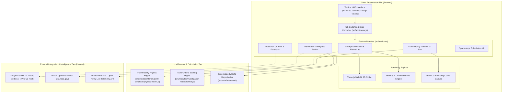

# SYSTEM ARCHITECTURE DOCUMENT

## GODEYE // PYRO-SI — Microgravity Fire Safety Intelligence

**Document Version:** 2.0.0  
**Project:** NASA Space Apps Challenge 2026 — Flame in Freefall  
**Author:** Senior Software & Scientific AI Architecture Team  

---

## 1. Executive Architecture Summary

**GODEYE // PYRO-SI** transforms a monolithic 2,532-line single-file prototype into an enterprise-grade, modular, and scientifically grounded architecture. The system decouples presentation, computation, reference telemetry, and future cloud services into distinct, testable layers.

The architecture emphasizes:
1. **Zero-Bloat Core**: Pure ECMAScript (ES2022) modular design running natively in modern browsers with zero bundling requirement for rapid iteration.
2. **Deterministic Data Separation**: 100% of hardcoded telemetry, historical incidents, and investigation records externalized into validated JSON schemas.
3. **Decoupled Physics & Rendering**: Separation of 3D WebGL tactical rendering (Three.js), 2D Canvas microgravity particle dynamics, and empirical mathematical flammability modeling.
4. **Extensible Service Layer**: Standardized API adapters ready to integrate NASA's Open PSI API, live ISS telemetry streams, and Google Gemini RAG intelligence.

---

## 2. High-Level Component Topology



---

## 3. Directory & File Organization

The project directory at `/Users/pavan/Desktop/PYRO-SI` is structured into clean architectural boundaries:

```text
PYRO-SI/
├── _ORIGINAL_SOURCE_BACKUP.html    # Preserved original monolithic reference
├── index.html                      # Clean, semantic HTML entry point
├── package.json                    # Development scripts & package metadata
├── .env.example                    # Environment secrets template
├── .gitignore                      # Git exclusion rules
│
├── docs/                           # Architecture & Engineering Governance
│   ├── EXISTING_SYSTEM_AUDIT.md    # Pre-migration forensic audit
│   ├── ARCHITECTURE.md             # This document
│   ├── GAP_ANALYSIS.md             # Data & feature gap evaluation
│   ├── DATASET_CATALOG.md          # NASA PSI investigation catalog
│   ├── SCIENTIFIC_VALIDATION.md    # Math transparency & empirical bounds
│   ├── GOOGLE_TECH_INTEGRATION.md  # Gemini & GCP implementation spec
│   ├── UI_UX_IMPROVEMENT_PLAN.md   # Hallmark design tokens & accessibility
│   ├── DEVELOPMENT_RULES.md        # Engineering standards & integrity rules
│   ├── IMPLEMENTATION_ROADMAP.md   # Prioritized multi-phase milestones
│   └── MIGRATION_AND_TESTING_REPORT.md # Test results & benchmark audit
│
├── public/                         # Static Web Assets
│   ├── index.html                  # Deployed static bundle
│   ├── assets/                     # 3D textures & audio alerts
│   ├── images/                     # Diagram illustrations & mission schematics
│   └── icons/                      # Tactical HUD SVG icons
│
├── src/                            # Modular Application Source
│   ├── app/                        # Application Initialization & Navigation
│   │   ├── main.js                 # App bootstrap orchestrator & DOM mounts
│   │   ├── router.js               # Multi-tab router & section switching
│   │   └── config.js               # Constants, storage keys & default state
│   │
│   ├── components/                 # Reusable UI Component Partials
│   │   ├── navigation/             # Tactical header & status ticker
│   │   ├── dashboard/              # Telemetry panels & metrics readouts
│   │   ├── visualization/          # Canvas wrappers & WebGL mount points
│   │   └── shared/                 # Range sliders, mode pills, buttons
│   │
│   ├── modules/                    # Self-Contained Domain Feature Modules
│   │   ├── godeye/                 # Module 1: 3D Globe, Flame Lab, Habitat Sync
│   │   ├── investigation-matrix/   # Module 2: Multi-criteria Ranker & Comparator
│   │   ├── flammability-simulator/ # Module 3: Combustion Math & Partial-G Chart
│   │   ├── research-copilot/       # Module 4: Knowledge Engine & Chat Controller
│   │   ├── mission-intelligence/   # Module 4 (Part B): Incident Forensics & Spinoffs
│   │   └── submission-kit/         # Module 5: Space Apps Deck & Clipboard Helper
│   │
│   ├── services/                   # Service Abstraction Layer
│   │   ├── nasa-psi/               # PSI API client & dataset parser
│   │   ├── gemini/                 # Google Gemini RAG adapter & prompt chains
│   │   ├── data-processing/        # CSV/JSON normalizers & provenance verifier
│   │   └── api/                    # Live orbital telemetry fetcher
│   │
│   ├── data/                       # Declarative Reference Repositories
│   │   ├── reference/              # Canonical JSON files (PSI, Habitats, Spinoffs)
│   │   └── schemas/                # JSON Schemas for data validation
│   │
│   ├── styles/                     # Tokenized Design System
│   │   ├── variables.css           # Design tokens (colors, fonts, radii, transitions)
│   │   ├── global.css              # Reset, typography, reduced motion, focus rings
│   │   └── components/hud.css      # Corner brackets, scanlines, glowing panels
│   │
│   └── utils/                      # Core Cross-Cutting Utilities
│       ├── dom.js                  # XSS sanitization (`escapeHtml`), debounce, text setter
│       └── math.js                 # Unit conversions, mathematical clamps
│
├── backend/                        # Cloud / Container Backend Tier (Planned Phase 2)
│   ├── api/                        # FastAPI endpoints for search & simulation
│   ├── ingestion/                  # Automated NASA PSI scraper & PDF parser
│   ├── processing/                 # Regolith dust discrimination algorithms
│   ├── intelligence/               # Gemini RAG vector search & chunk embeddings
│   └── models/                     # Scientific ML models for LOI prediction
│
├── tests/                          # Automated Verification Suite
│   ├── unit/                       # Physics formulas & ranker unit tests
│   ├── scientific/                 # Partial-G curve & boundary validation
│   └── test-runner.js              # Zero-dependency test runner
│
└── scripts/                        # Maintenance & Ingestion Scripts
    ├── setup/                      # Environment verification & dependencies
    ├── data-ingestion/             # PSI data fetchers & DOI validators
    └── validation/                 # Mathematical monotonicity checks
```

---

## 4. Module Responsibilities & Contracts

### 4.1 Module 1: GODEYE 3D Orbital & Flame Lab
- **`orbital-globe.js`**: Initializes Three.js WebGL scene, lighting, Earth sphere, latitude/longitude tactical grid, ISS orbit ring, Artemis cislunar trajectory, and user drag interactions.
- **`flame-chamber.js`**: Houses the 2D Canvas flame animation with 4 physical regimes:
  - `0g`: Spherical blue diffusion flame with cool flame outer ring and inward diffusion arrows.
  - `lunar`: 0.16g buoyant plume elongation with oxygen-enriched color grading.
  - `insideout`: ACME CFI-G inverted gravity annular flame ring.
  - `1g`: Flickering yellow teardrop flame with buoyancy draft.
- **`habitat-controller.js`**: Synchronizes habitat selection (`ISS`, `MOON`, `ARTEMIS`, `SUIT`, `MARS`) with HUD telemetry readouts and updates Top PSI recommended studies.

### 4.2 Module 2: PSI Investigation Matrix & Ranker
- **`ranker.js`**: Pure mathematical function evaluating the composite relevance of each investigation based on 4 user-controlled priority weights:
  $$\text{Score} = \frac{\sum (w_i \cdot s_i)}{\sum w_i}$$
- **`matrix-renderer.js`**: Filters investigations by rack type (`CIR`, `MSG`, `CYGNUS`, `LUNAR`), fuel state (`Solid`, `Gaseous`, `Liquid`, `Particulate`), and full-text keyword search.
- **`comparator.js`**: Renders side-by-side technical specification tables for up to 3 selected studies and synthesizes automated facility compatibility and fuel regime insights.

### 4.3 Module 3: Predictive Flammability & Partial-G Simulator
- **`physics-model.js`**: Computes Limiting Oxygen Index (LOI), oxygen partial pressure ($p\text{O}_2$), effective ventilation velocity ($v_{\text{eff}} = \sqrt{v_{\text{forced}}^2 + v_{\text{buoyant}}^2}$), composite risk score ($8\text{--}99\%$), and specific material flame spread rates (SIBAL fabric, PMMA acrylic, Silicone, Nomex).
- **`partial-g-chart.js`**: 2D Canvas engine graphing flame spread velocity across the gravity continuum ($0g \to 1.0g$), visually locating the intermediate partial-gravity flammability peak observed in ACME CFI-G.
- **`presets.js`**: Provides instant one-click environmental presets for ISS nominal, Lunar base, EVA suit, CFI-G test chamber, and Earth baseline.

### 4.4 Module 4: Research Co-Pilot, Incidents & Spinoffs
- **`knowledge-engine.js`**: Evidence lookup matching user questions against verified NASA PSI findings (Cool Flames, Saffire, CIR/MDCA, Lunar Base, Fire Suppression).
- **`copilot-controller.js`**: Manages the terminal output interface with full HTML escaping to guarantee immunity against cross-site scripting (XSS).
- **`incidents-renderer.js`**: Renders historical fire forensics (Apollo 1, Apollo 13, Mir 1997, Artemis II) and connects them to terrestrial spinoff applications (ultrafine water mist, laser dust detectors, firefighter turnout gear).

### 4.5 Module 5: Space Apps Submission Kit
- **`submission-blocks.js`**: Formats the project summary, detailed technical submission, 7-slide presentation blueprint, and NASA open data references.
- **`clipboard-helper.js`**: Modern asynchronous `navigator.clipboard.writeText` implementation with fallback and visual button confirmation.

---

## 5. Security & Scientific Integrity Architecture

1. **Strict Input Sanitization**:
   All user queries entered in the Co-Pilot or search bars pass through `escapeHtml()` before DOM insertion, completely preventing HTML injection and XSS vectors.
2. **Scientific Limitation Bounding**:
   All calculated outputs in Module 3 explicitly display empirical qualification labels (`Empirical Demonstration Model`). Inputs are clamped within physically plausible bounds ($15\text{--}100\%\text{ O}_2$, $4\text{--}15\text{ psi}$, $0\text{--}55\text{ cm/s}$ ventilation).
3. **Timer Leakage Prevention**:
   Telemetry tickers and requestAnimationFrame render loops implement clean teardown and re-initialization hooks to prevent multiple intervals or GPU memory leaks.
