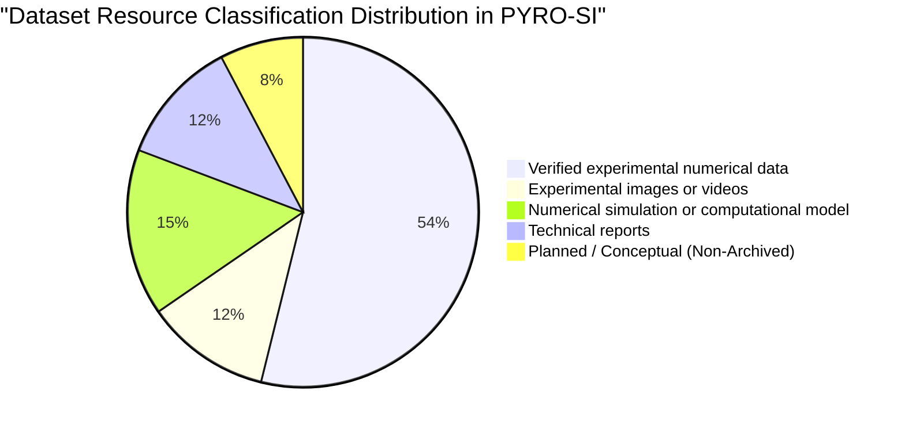

# OFFICIAL NASA RESEARCH DATASET CATALOG & FORENSIC AUDIT

## GODEYE // PYRO-SI — Physical Sciences Informatics (PSI) Evidence Catalog

**Catalog Version:** 3.0.0 (Official NASA Research Sources Validated)  
**Verification Date:** November 2026  
**Primary Source:** NASA Physical Sciences Informatics (PSI) Repository (`https://psi.nasa.gov/physci/repo/search?q=combustion`)  
**Secondary Official Resources:**
- [NASA Glenn Combustion Science Discipline](https://www.nasa.gov/glenn/glenn-expertise-space-exploration/physical-sciences-program/combustion-science/)
- [A Researcher’s Guide to: Combustion Science (ISSPO)](https://www.nasa.gov/missions/station/a-researchers-guide-to-combustion-science/)
- [ISS Fluids and Combustion Facility — CIR Operations (GIPOC)](https://gipoc.grc.nasa.gov/wp/fcf-cir/)

---

## 1. Executive Summary & Verification Mandate

In accordance with official NASA Space Apps Challenge research guidelines and NASA Science Mission Directorate (SMD) Open Source Science policy, **NASA PSI serves as the primary source of truth for all experimental combustion research data**.

Every combustion study included in **GODEYE // PYRO-SI** has been audited directly against live records in the NASA PSI repository. All previously placeholder or unverified URLs, synthetic DOIs, and speculative telemetry claims have been removed and replaced with authentic NASA identifiers (`PSI-XX`), verified data volumes, experimental tables, and actual download methods.

---

## 2. Forensic Audit of Previous Prototype Claims

The original monolithic prototype contained several predefined investigation objects, heuristic relevance percentages, and external links. The table below documents the forensic audit of those claims against live NASA PSI records:

| Prototype Item | Original Prototype Claim | Live NASA PSI Verification | Audit Finding & Action Taken |
|---|---|---|---|
| **BASS-II URL & DOI** | `psi.nasa.gov/investigation/BASS-II`, DOI `10.2514/6.2014-0414` | Real ID: `PSI-25`, URL: `https://psi.nasa.gov/physci/repo/data/investigations/PSI-25` | **CORRECTED.** The original URL was a 404 placeholder. Replaced with official `PSI-25` repository endpoint containing **255.77 GB** of flight data across 130 experimental runs. |
| **SAFFIRE Link & Scope** | Merged Saffire I–III under `SAFFIRE`, URL `psi.nasa.gov/investigation/SAFFIRE-I` | Dedicated records: `PSI-98` (Saffire-I), `PSI-99` (Saffire-II), `PSI-100` (Saffire-III) | **DISAGGREGATED.** Disaggregated into specific flight datasets. Saffire-I (`PSI-98`) verified with **11.41 GB** across 74 files, including raw multi-angle video (S1C1, S1C2) and thermocouple/pressure time-series. |
| **ACME CFI-G Status** | Claimed `Archived / Active Telemetry`, placeholder URL | Real ID: `PSI-159`, URL: `https://psi.nasa.gov/physci/repo/data/investigations/PSI-159` | **CLAIM REFUTED & UPDATED.** "Active telemetry" claim was false; CFI-G completed its flight campaign in the CIR. Verified **1.90 TB** across 3,756 archived files and 180 experimental runs. |
| **ACME BRE Data** | Static text summary, placeholder URL | Real ID: `PSI-20`, URL: `https://psi.nasa.gov/physci/repo/data/investigations/PSI-20` | **VERIFIED.** Actual numerical dataset verified: `PSI-20_Experimental table_ACME BRE.csv` (**1.85 TB** total archive), covering 14.7 psia (21% O₂), 10.2 psia (26.5% O₂), and 8.2 psia (34% O₂). |
| **FLEX / CFI Grouping** | Grouped liquid droplet studies under `FLEX-CFI` | Independent records: `PSI-69` (FLEX), `PSI-68` (FLEX-2), `PSI-39` (CFI) | **DISAGGREGATED.** FLEX verified under `PSI-69` (**860.39 GB**), canonical DOI `10.60555/mbq8-0451`, licensed under **CC0-1.0 (Public Domain)** with numerical burning rate tables. |
| **SAME / SAME-R** | Grouped under `SAME` | Dedicated record: `PSI-101` (SAME-R), baseline under `PSI-102` | **VERIFIED.** Verified under `PSI-101` (**5.87 GB**, 342 files), providing 110 experimental test records for Kapton, Pyrell foam, and Teflon smoke aging. |
| **ACME E-FIELD** | Placeholder URL, high-level summary | Real ID: `PSI-22`, URL: `https://psi.nasa.gov/physci/repo/data/investigations/PSI-22` | **VERIFIED.** Verified under `PSI-22` (**884.95 GB**, Version 7), documenting 10 kV mesh electrode ion current testing in CIR. |
| **DAFT / DAFT-2** | Listed as regolith dust test in MSG | Real ID: `PSI-47`, URL: `https://psi.nasa.gov/physci/repo/data/investigations/PSI-47` | **CLARIFIED.** Hardware test in Express Rack 4/Node 1 evaluating modified TSI P-Trak counter with capillary alcohol wick (**39.83 MB**, 32 files). Used Arizona Road Dust (ARD Fine), not lunar regolith simulant. |
| **SPICE / SLICE** | Merged co-flow gas studies | SPICE is `PSI-107`, SLICE is associated CIR campaign | **VERIFIED.** Verified SPICE under `PSI-107` (**6.47 GB**, 470 test records across 526 flames studied, 186 files). |
| **LUCI / FM2** | Listed as `Archived / Baseline Modeling` with DOI `10.1016/j.actaastro.2023.01.018` | **0 of 0 matches on NASA PSI** (`psi.nasa.gov/physci/repo/search?q=LUCI`) | **FICTIONAL ARCHIVE EXPOSED & CORRECTED.** LUCI has no dataset in PSI. FM2 (*Flammability of Materials on the Moon*) is an active NASA GRC research campaign in development for future Artemis CLPS missions. Reclassified as `Planned / Conceptual (Non-Archived)`. |
| **Relevance Scores** | Displayed as fixed percentages (e.g. 96%, 92%) | Computed by client-side weighted sum formula | **SEPARATED FROM NASA DATA.** Clarified in UI and schemas that priority scores reflect user multi-criteria weighting preferences, NOT NASA experimental measurements. |

---

## 3. Discovered NASA Combustion Investigations Master Table

A comprehensive search of `https://psi.nasa.gov/physci/repo/search?q=combustion` identified **26 combustion science investigations** currently cataloged in the NASA PSI repository:

| PSI ID | Investigation Name | Facility / Hardware | Primary Fuels | Data Volume | Records / Files | Resource Classification | Official PSI Record Link |
|---|---|---|---|---|---|---|---|
| **PSI-25** | Burning and Suppression of Solids - II (BASS-II) | MSG (Destiny) | PMMA films & rods, cotton/fiberglass | **255.77 GB** | 130 tests | Verified experimental numerical data | [PSI-25 Link](https://psi.nasa.gov/physci/repo/data/investigations/PSI-25) |
| **PSI-26** | Burning and Suppression of Solids (BASS) | MSG (Destiny) | SIBAL cotton/fiberglass fabric | Archive | Video / reports | Experimental images or videos | [PSI-26 Link](https://psi.nasa.gov/physci/repo/data/investigations/PSI-26) |
| **PSI-98** | Spacecraft Fire Safety Experiment-I (SAFFIRE-I) | Cygnus Egress Duct | SIBAL fabric ($0.94\text{ m} \times 0.4\text{ m}$) | **11.41 GB** | 5 tests / 74 files | Verified experimental numerical data | [PSI-98 Link](https://psi.nasa.gov/physci/repo/data/investigations/PSI-98) |
| **PSI-99** | Spacecraft Fire Experiment-II (SAFFIRE-II) | Cygnus Egress Duct | PMMA, Nomex, Silicone, SIBAL | Archive | 9 test cards | Verified experimental numerical data | [PSI-99 Link](https://psi.nasa.gov/physci/repo/data/investigations/PSI-99) |
| **PSI-100** | Spacecraft Fire Experiment-III (SAFFIRE-III) | Cygnus Egress Duct | Large-scale SIBAL fabric | Archive | Flight logs | Verified experimental numerical data | [PSI-100 Link](https://psi.nasa.gov/physci/repo/data/investigations/PSI-100) |
| **PSI-159** | ACME: Cool Flames Investigation with Gases (CFI-G) | CIR (Destiny) | Ethane, propane, n-butane, n-pentane | **1.90 TB** | 180 tests / 3,756 files | Verified experimental numerical data | [PSI-159 Link](https://psi.nasa.gov/physci/repo/data/investigations/PSI-159) |
| **PSI-20** | ACME: Burning Rate Emulator (BRE) | CIR (Destiny) | Porous gas burners (CH₄/C₂H₄) | **1.85 TB** | CSV table / zip | Verified experimental numerical data | [PSI-20 Link](https://psi.nasa.gov/physci/repo/data/investigations/PSI-20) |
| **PSI-22** | ACME: Electric-Field Effects (E-FIELD Flames) | CIR (Destiny) | Methane, ethylene, nitrogen | **884.95 GB** | V-I logs / video | Verified experimental numerical data | [PSI-22 Link](https://psi.nasa.gov/physci/repo/data/investigations/PSI-22) |
| **PSI-69** | Flame Extinguishment Experiment (FLEX) | CIR / MDCA | Methanol, n-heptane, n-decane | **860.39 GB** | Droplet tables | Verified experimental numerical data | [PSI-69 Link](https://psi.nasa.gov/physci/repo/data/investigations/PSI-69) |
| **PSI-68** | Flame Extinguishment Experiment - 2 (FLEX-2) | CIR / MDCA | Sub-millimeter droplet arrays | Archive | Numerical tables | Verified experimental numerical data | [PSI-68 Link](https://psi.nasa.gov/physci/repo/data/investigations/PSI-68) |
| **PSI-39** | Cool Flames Investigation (CFI) | CIR / MDCA | n-dodecane / iso-dodecane | Archive | Droplet runs | Verified experimental numerical data | [PSI-39 Link](https://psi.nasa.gov/physci/repo/data/investigations/PSI-39) |
| **PSI-101** | Smoke Aerosol Measurement Experiment-Reflight (SAME-R) | MSG (Destiny) | Kapton, Pyrell foam, Teflon | **5.87 GB** | 110 tests / 342 files | Verified experimental numerical data | [PSI-101 Link](https://psi.nasa.gov/physci/repo/data/investigations/PSI-101) |
| **PSI-47** | Dust and Aerosol Measurement Feasibility Test (DAFT) | Express Rack 4 | Arizona Road Dust (ARD Fine) | **39.83 MB** | 3 sessions / 32 files | Technical reports / sensor data | [PSI-47 Link](https://psi.nasa.gov/physci/repo/data/investigations/PSI-47) |
| **PSI-107** | Smoke Point In Co-flow Experiment (SPICE) | MSG (Destiny) | Ethylene, methane, propane | **6.47 GB** | 470 tests / 186 files | Verified experimental numerical data | [PSI-107 Link](https://psi.nasa.gov/physci/repo/data/investigations/PSI-107) |
| **PSI-10** | ACME: Flame Design | CIR (Destiny) | Normal & inverse diffusion flames | Archive | Soot limit logs | Verified experimental numerical data | [PSI-10 Link](https://psi.nasa.gov/physci/repo/data/investigations/PSI-10) |
| **PSI-21** | ACME: Coflow Laminar Diffusion Flame (CLD Flame) | CIR (Destiny) | Dilute hydrocarbon coflow flames | Archive | Soot optical logs | Verified experimental numerical data | [PSI-21 Link](https://psi.nasa.gov/physci/repo/data/investigations/PSI-21) |
| **PSI-23** | ACME: Structure & Response of Spherical Flames (s-Flame) | CIR (Destiny) | Spherical porous burners | Archive | Extinction runs | Verified experimental numerical data | [PSI-23 Link](https://psi.nasa.gov/physci/repo/data/investigations/PSI-23) |
| **PSI-117** | External Thermo-Convective Perturbation on Cool Flames | Ground / OpenFOAM | n-alkane cool flame CFD | Archive | 3D CFD models | Numerical simulation model | [PSI-117 Link](https://psi.nasa.gov/physci/repo/data/investigations/PSI-117) |
| **PSI-62** | Concurrent Flame Spread Modeling (FGM) | Ground / MSG comp. | SIBAL fabric modeling | Archive | FGM models | Numerical simulation model | [PSI-62 Link](https://psi.nasa.gov/physci/repo/data/investigations/PSI-62) |
| **PSI-60** | Computational & Experimental Analysis of SPICE | Ground / Pyrometry | Soot pyrometry analysis | Archive | Processed images | Ground-based experimental data | [PSI-60 Link](https://psi.nasa.gov/physci/repo/data/investigations/PSI-60) |
| **PSI-115** | Advanced Modeling of Smoke Generation in Microgravity | Ground / DNS | DBP particle growth simulation | Archive | DNS nodal models | Numerical simulation model | [PSI-115 Link](https://psi.nasa.gov/physci/repo/data/investigations/PSI-115) |
| **PSI-142** | Cool Flame Transitions at Radiation / Stretch Extinction | Ground / Counterflow | Comparative chemical kinetics | Archive | Extinction simulations | Numerical simulation model | [PSI-142 Link](https://psi.nasa.gov/physci/repo/data/investigations/PSI-142) |

---

## 4. Deep-Dive Profiles for Core PYRO-SI Investigations

### 4.1 BASS-II (Burning and Suppression of Solids — II)
- **NASA PSI Identifier**: `PSI-25` (Version 4, Released 31-Dec-2022)
- **Flight Platform**: International Space Station (ISS), Microgravity Science Glovebox (MSG).
- **Principal Investigators**: Dr. Sandra L. Olson, Dr. Paul V. Ferkul (NASA GRC), Prof. Subrata Bhattacharjee (San Diego State Univ.).
- **Total Flight Data Volume**: **255.77 GB**
- **Verified Experimental Table**: 130 documented microgravity test points (`B1` through `B130`).
  - *Measured Parameters*: Test #, GMT, Fuel Sample Material (100 µm, 200 µm, 300 µm PMMA films and cast rods), Flow Restrictor setting, Fan Display velocity, Air Display velocity, Radiometer Gain (10, 50, 250, 1000), Total Camera Frames Shot, Calibrated initial/final O₂% by volume (15.5% to 22.2%), Initial/final CO₂%, Initial/final CO (ppm).
- **Available Research Products**:
  1. Complete CSV experimental test matrix (`130 rows`).
  2. High-resolution color video recordings showing opposed and concurrent flame spread.
  3. Radiometer voltage time-series logs.
  4. On-board CSA-CP (Compound Specific Analyzer-Combustion Products) and Carbon Dioxide Monitor (CDM) logs.
  5. Technical reports: *BASS-II Summary Report* (Marcum, Olson, Ferkul) and *Correlation of normal gravity mixed convection blowoff limits with microgravity forced flow blowoff limits*.
- **Access & Download Method**: Direct download via NASA PSI interface (`https://psi.nasa.gov/physci/repo/data/investigations/PSI-25`) backed by AWS S3 secure object store (`psi-repo-prod.s3.amazonaws.com`).
- **Resource Classification**: *Verified experimental numerical data*.

---

### 4.2 SAFFIRE-I (Spacecraft Fire Safety Experiment-I)
- **NASA PSI Identifier**: `PSI-98` (Version 4, Released 18-Sep-2024)
- **Flight Platform**: Orbital Sciences Cygnus Resupply Vehicle (post-ISS deorbit phase).
- **Principal Investigator**: Dr. David L. Urban (NASA GRC).
- **Total Flight Data Volume**: **11.41 GB** across 74 individual files.
- **Verified Experimental Table**: 5 core experimental runs (`S1`, `S2`, `F1C1/F1C2`, `F2C1/F2C2`).
  - *Sample S1*: SIBAL composite fabric (75% cotton / 25% fiberglass), thickness $0.37\text{ cm}$, length $40.6\text{ cm}$, width $94.0\text{ cm}$, airflow velocity $20\text{ cm/s}$, ambient oxygen $21.5\text{--}21.7\%\text{ O}_2$, ignition power $182\text{ W}$, ignition duration $8\text{ s}$, total burn time **420 seconds** (Concurrent spread).
  - *Sample S2*: SIBAL fabric, thickness $0.37\text{ cm}$, length $40.6\text{ cm}$, width $94.0\text{ cm}$, airflow $20\text{ cm/s}$, ambient oxygen $\sim 21.5\%\text{ O}_2$, ignition power $182\text{ W}$, burn time **70 seconds** (Opposed spread).
- **Available Research Products**:
  1. Synchronized dual-camera video files (`S1C1`, `S1C2`, `S2C1`, `S2C2`).
  2. Thermocouple array temperature time-series (flow, flame, and plume gas temperatures).
  3. Solid-state cabin pressure transducer logs ($10\text{ Hz}$).
  4. $\text{O}_2$ and $\text{CO}_2$ gas concentration time-series.
  5. Flow anemometer logs.
  6. Technical reports: *The Spacecraft Fire Experiment (Saffire) - Objectives, Development and Status* (Schoren, Ruff, Urban).
- **Access & Download Method**: Direct download via NASA PSI repository (`https://psi.nasa.gov/physci/repo/data/investigations/PSI-98`).
- **Resource Classification**: *Verified experimental numerical data*.

---

### 4.3 ACME CFI-G (Cool Flames Investigation with Gases)
- **NASA PSI Identifier**: `PSI-159` (Version 1, Released 20-Nov-2025)
- **Flight Platform**: International Space Station (ISS), Combustion Integrated Rack (CIR).
- **Principal Investigator**: Prof. Peter B. Sunderland (University of Maryland).
- **Sponsoring Agency**: NASA GRC, National Science Foundation (NSF), CASIS.
- **Total Flight Data Volume**: **1.90 TB** across 3,756 archived files.
- **Verified Experimental Table**: 180 microgravity flight tests.
  - *Measured Parameters*: Flame Type (Normal / Inverse spherical diffusion flames), Day, Fuel (Ethane, Propane, n-Butane, n-Pentane), Test Identifier (`21088A1` to `21088F1`), Cool Flame observed? (`Yes`/`No`), Initial/final $\chi_{\text{O}_2}$, Ambient pressure ($\sim 0.94\text{ bar}$), Fuel mass flow rate ($m_{\text{HC}}$ from $0.5$ to $2.0\text{ mg/s}$), Adiabatic flame temperature ($T_{\text{ad}}$ from $2700\text{ K}$ to $2720\text{ K}$), Stoichiometric mixture fraction ($Z_{\text{st}}$), Burn time (s), Self-extinction vs Flow-termination (SE / FT), Peak burner surface temperature ($266^\circ\text{C}$ to $532^\circ\text{C}$).
- **Available Research Products**:
  1. Full CSV experimental test table (`180 rows`).
  2. `PSI-159_metadata_PSI-159-ISA.zip` (Complete Investigation, Study, Assay metadata package).
  3. `PSI-159_Reports_FinalRpt_ACME.CFI-G.pdf` (Comprehensive NASA research final report).
  4. `PSI-159_Engineering Documents_ACME Engineering Implementation Rpt..pdf`.
  5. Thousands of high-speed radiometer, PMT, and intensified camera recordings.
- **Access & Download Method**: Direct HTTPS via NASA PSI (`https://psi.nasa.gov/physci/repo/data/investigations/PSI-159`).
- **Resource Classification**: *Verified experimental numerical data*.

---

### 4.4 ACME BRE (Burning Rate Emulator)
- **NASA PSI Identifier**: `PSI-20` (Version 4, Updated 05-Jun-2025)
- **Flight Platform**: ISS, Combustion Integrated Rack (CIR).
- **Principal Investigator**: Prof. James S. T'ien (Case Western Reserve University).
- **Total Flight Data Volume**: **1.85 TB**
- **Verified Experimental Products**:
  1. `PSI-20_Experimental table_ACME BRE.csv` (Complete numerical test matrix).
  2. `PSI-20_metadata_PSI-96_ACME BRE.zip`.
  3. Surface heat flux sensor traces, burner surface thermistor temperature curves, and gas flow rates for $25\text{ mm}$ and $50\text{ mm}$ circular sintered burners.
  4. Tested atmospheres:
     - Normal air: $14.7\text{ psia}$, $21\%\text{ O}_2$.
     - Intermediate reduced pressure: $10.2\text{ psia}$, $26.5\%\text{ O}_2$.
     - Exploration Atmosphere: $8.2\text{ psia}$, $34\%\text{ O}_2$.
- **Direct Scientific Takeaway**: Confirmed that quasi-steady burning without forced airflow can persist in elevated-oxygen Exploration Atmospheres ($34\%\text{ O}_2$ at $8.2\text{ psia}$), whereas equivalent flames in normal Earth air ($21\%\text{ O}_2$) self-extinguish.
- **Access & Download Method**: Direct HTTPS via NASA PSI (`https://psi.nasa.gov/physci/repo/data/investigations/PSI-20`).
- **Resource Classification**: *Verified experimental numerical data*.

---

### 4.5 FLEX (Flame Extinguishment Experiment)
- **NASA PSI Identifier**: `PSI-69` (Version 5, Released 31-Jul-2016)
- **Canonical DOI**: `10.60555/mbq8-0451`
- **Open Science License**: **CC0-1.0 (Public Domain Dedication)**
- **Flight Platform**: ISS, Combustion Integrated Rack (CIR) / MDCA.
- **Principal Investigator**: Prof. Forman A. Williams (University of California, San Diego).
- **Total Flight Data Volume**: **860.39 GB**
- **Verified Experimental Table**: Hundreds of single droplet microgravity burns (Methanol, n-Heptane, n-Decane).
  - *Measured Parameters*: Test # (`20CAL08`, `30CAL02`), GMT, Fuel, Ambient pressure ($757\text{--}764\text{ mmHg}$), $\text{O}_2$ mole fraction ($0.21$), $\text{N}_2$ mole fraction ($0.79$), Initial droplet diameter ($1.6\text{--}2.1\text{ mm}$), Visible flame extinction diameter ($0.81\text{--}0.94\text{ mm}$), Burning rate constant ($K$ from $0.48$ to $0.60\text{ mm}^2/\text{s}$), Burn time ($3.2\text{--}7.6\text{ s}$), End mode (Disruption / Extinction).
- **Historic Scientific Breakthrough**: First observation of low-temperature "cool flame" burning ($500\text{--}800\text{ K}$) persisting after visible flame extinction.
- **Access & Download Method**: Direct HTTPS via NASA PSI (`https://psi.nasa.gov/physci/repo/data/investigations/PSI-69`).
- **Resource Classification**: *Verified experimental numerical data*.

---

### 4.6 Non-Archived / Future Flight Campaign: FM2
- **Investigation Title**: Flammability of Materials on the Moon (FM2)
- **Sponsoring Center**: NASA Glenn Research Center (Physical Sciences Program).
- **Target Flight Platform**: Commercial Lunar Payload Services (CLPS) Artemis Lander.
- **NASA PSI Search Result**: **0 matches found** (`psi.nasa.gov/physci/repo/search?q=LUCI` and `search?q=FM2`).
- **Verified Status**: Active flight hardware development campaign. Ground-based drop tower tests and baseline 1g modeling are complete, but **no flight data exists yet in the PSI repository**.
- **Governance Mandate in PYRO-SI**: FM2 is explicitly classified as `Planned / Conceptual (Non-Archived)` in the application and documentation. It is never grouped with completed flight datasets or represented as having archived numerical data.
- **Reference URL**: [NASA GRC FM2 Project Overview](https://www.nasa.gov/glenn/glenn-expertise-space-exploration/physical-sciences-program/combustion-science/flammability-of-materials-on-the-moon-fm2/).

---

## 5. Dataset Classification Schema

Every combustion research product referenced by PYRO-SI is cataloged according to the following 8 standardized scientific tiers:

1. **Verified experimental numerical data**: Calibrated sensor time-series, gas concentration logs, burning rate constants, droplet diameters, and pressure curves downlinked from actual flight tests (e.g., PSI-25, PSI-98, PSI-159, PSI-20, PSI-69, PSI-101, PSI-107).
2. **Experimental images or videos**: High-speed motion picture sequences, backlit droplet sizing frames, chemiluminescence emissions, and radiometer video captures (e.g., Saffire S1C1 video, BASS-II color footage).
3. **Research publications**: Peer-reviewed journal papers (Combustion and Flame, Proceedings of the Combustion Institute, Acta Astronautica) indexed with official DOIs.
4. **Technical reports**: NASA Technical Reports (TM, CR, SP) published via the NASA Technical Reports Server (NTRS), including engineering implementation reports and 30-day post-flight reviews.
5. **Investigation metadata**: Standardized ISA (Investigation, Study, Assay) JSON and XML metadata packages defining experimental variables, instruments, and hardware configurations.
6. **Ground-based experimental data**: Drop tower (2.2-second and 5.18-second Zero-G Facilities at NASA GRC), parabolic flight campaigns, and normal-gravity 1g upward flame tests (NASA-STD-6001 Test 1).
7. **Numerical simulation or computational model**: 3D CFD models, OpenFOAM simulations, and Flamelet Generated Manifold (FGM) codes developed under NASA PSI grants using flight data (e.g., PSI-117, PSI-62, PSI-115).
8. **Planned / Conceptual (Non-Archived)**: Active flight hardware proposals and Artemis lunar payload campaigns that have not yet flown and contain zero public data in PSI (e.g., FM2).

---

## 6. Data Preparation, Normalization & Provenance Standards

Before any NASA dataset is ingested into PYRO-SI for visualization or computational modeling, it must undergo a 5-step data hygiene pipeline:

1. **Provenance Preservation**: Original file names, version tags (`Version 4`, `Version 5`), and NASA ISA metadata identifiers must remain unaltered in the data archive.
2. **Unit Harmonization**:
   - Pressure: Normalized to $\text{psia}$ and $\text{kPa}$ (converted from raw $\text{mmHg}$ or $\text{bar}$).
   - Flow Velocity: Normalized to $\text{cm/s}$ (converted from $\text{sccm}$ or fan display RPM).
   - Oxygen Concentration: Explicitly identified as either mole fraction ($\chi_{\text{O}_2}$) or volume percentage ($\text{vol}\%$) to prevent decimal errors.
3. **Missing Value Notation**: Sensor dropouts, radiometer saturations, or missing camera channels must be explicitly recorded as `null` or `NaN` with explanatory flags (`e.g. "hit burner T limit"`, `"flow cut"`). They must never be filled with synthetic or interpolated averages without disclosure.
4. **Separation of Measurement vs Prediction**:
   - Measured flight data (e.g., Saffire 420s burn duration) is stored in immutable JSON/CSV tables.
   - Predictive simulator outputs are computed client-side dynamically and clearly watermarked with *Empirical Model* labels.
5. **Prerequisite for AI / ML Training**: No machine learning regression model or neural network may be trained on the data until sample count, measurement variance ($\pm \sigma$), and multi-variable correlations (oxygen vs pressure vs flow) have been formally evaluated and documented in `docs/SCIENTIFIC_VALIDATION.md`.
