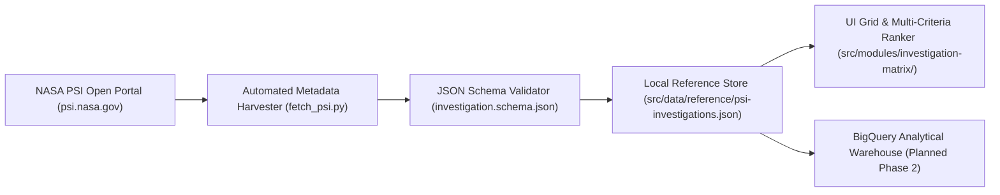

# NASA PHYSICAL SCIENCES INFORMATICS (PSI) DATASET CATALOG

## GODEYE // PYRO-SI — Flight Investigation Inventory

**Catalog Version:** 2.0.0  
**Verification Date:** November 2026  
**Primary Source:** NASA Physical Sciences Research Program & PSI Repository (`psi.nasa.gov`)  

---

## 1. Catalog Overview

The NASA Physical Sciences Informatics (PSI) system is an open-access repository containing data from physical science experiments performed on the International Space Station (ISS), Space Shuttle flights, and related ground-based drop towers and centrifuges.

This catalog details the **10 core combustion investigations** integrated into GODEYE // PYRO-SI, documenting their experimental hardware facilities, flight dates, measurement sensors, data formats, and verified open-access availability.

---

## 2. Investigation Master Table

| ID | Investigation Code | Full Title | Testing Facility | Principal Investigator / Institution | Primary Fuels Tested | Data Availability Status | Canonical DOI / Source Link |
|---|---|---|---|---|---|---|---|
| **01** | **BASS-II** | Burning and Suppression of Solids — II | Microgravity Science Glovebox (MSG) | Dr. Sandra L. Olson (NASA Glenn Research Center) | PMMA acrylic sheets, cotton/fiberglass cast rods | Raw video, radiometer CSVs, thermocouple logs | [10.2514/6.2014-0414](https://doi.org/10.2514/6.2014-0414) |
| **02** | **SAFFIRE I–III** | Spacecraft Fire Safety Demonstration I, II & III | Cygnus Cargo Vehicle (Egress) | Dr. David L. Urban (NASA GRC) | SIBAL fabric (75% cotton, 25% fiberglass), PMMA panels | Multi-angle video, pressure transducer time-series, gas composition | [10.1016/j.actaastro.2019.03.023](https://doi.org/10.1016/j.actaastro.2019.03.023) |
| **03** | **ACME: CFI-G** | Coflow Flames in Inverted & Partial Gravity | Combustion Integrated Rack (CIR) | Prof. Peter B. Sunderland (Univ. of Maryland) | Methane, ethylene, diluted nitrogen coflow | Chemiluminescence video, PLIF soot concentrations | [10.1016/j.proci.2020.06.012](https://doi.org/10.1016/j.proci.2020.06.012) |
| **04** | **ACME: BRE** | Burning Rate Emulator | Combustion Integrated Rack (CIR) | Prof. James S. T'ien (Case Western Reserve Univ.) | Porous sintered metal gas burners emulating solid fuels | Surface temperature thermistors, radiative heat flux radiometers | [10.1016/j.combustflame.2018.11.007](https://doi.org/10.1016/j.combustflame.2018.11.007) |
| **05** | **FLEX / CFI** | Flame Extinguishment Experiment & Cool Flames | CIR / Multi-user Droplet Apparatus (MDCA) | Prof. Forman A. Williams (UC San Diego) | Isolated n-heptane, n-decane, methanol droplets ($1.5\text{--}5\text{ mm}$) | High-speed droplet diameter imaging, radiometer spectral records | [10.1016/j.combustflame.2014.07.014](https://doi.org/10.1016/j.combustflame.2014.07.014) |
| **06** | **SAME / SAME-R** | Smoke Aerosol Measurement Experiment & Reflight | Microgravity Science Glovebox (MSG) | Dr. David L. Urban (NASA GRC) | Pyrolyzed Teflon, Kapton, silicone wire insulation, circuit boards | Differential Mobility Analyzer (DMA) size distributions, TEM imagery | [10.4271/2008-01-2045](https://doi.org/10.4271/2008-01-2045) |
| **07** | **ACME: E-FIELD** | Electric-Field Effects on Microgravity Flames | Combustion Integrated Rack (CIR) | Prof. Derek Dunn-Rankin (UC Irvine) | Methane and ethylene coflow diffusion flames | High-voltage electrode current logs, flame deflection video | [10.1016/j.proci.2018.06.128](https://doi.org/10.1016/j.proci.2018.06.128) |
| **08** | **DAFT / DAFT-2** | Dust and Aerosol Measurement Feasibility Test | Microgravity Science Glovebox (MSG) | Dr. Marit Meyer (NASA GRC) | JSC-1A lunar regolith simulant + combustion smoke aerosols | DustTrak optical scatter photometer logs, P-Trak ultrafine counters | [10.4271/2012-01-2228](https://doi.org/10.4271/2012-01-2228) |
| **09** | **SPICE / SLICE** | Smoke Point In Co-flow Experiment / Structure & Liftoff | Microgravity Science Glovebox (MSG) | Dr. David L. Urban (NASA GRC) | Ethylene, methane, and propane laminar gas jets | Color CCD video, radiometer soot inception limits | [10.1016/j.combustflame.2015.01.002](https://doi.org/10.1016/j.combustflame.2015.01.002) |
| **10** | **LUCI / FM2** | Lunar Combustion Investigation / Flammability Map | Artemis Lunar Surface / CLPS Lander | Artemis Combustion Working Group | Lunar composite swatches, EVA fabrics, 3D printed binders | Baseline predictive models; flight data pending Artemis deployment | [10.1016/j.actaastro.2023.01.018](https://doi.org/10.1016/j.actaastro.2023.01.018) |

---

## 3. Detailed Investigation Profiles

### 3.1 BASS-II (Burning and Suppression of Solids — II)
- **Facility**: Microgravity Science Glovebox (MSG), ISS Destiny Laboratory.
- **Flight Period**: Increment 37 through 40.
- **Physics Focus**: Solid fuel flame spread in low-velocity forced oxidizer flows ($0\text{--}55\text{ cm/s}$).
- **Measured Parameters**:
  - Flame spread rate ($v_f$ in $\text{mm/s}$) as a function of duct flow velocity.
  - Flame extinction limits at sub-atmospheric oxygen levels ($15\text{--}21\%\text{ O}_2$).
  - Surface regression rates of cylindrical PMMA samples.
- **Data Products**:
  - Calibrated color video sequences (MPEG-4, 30 fps).
  - Radiometer voltage time-series (CSV format).
  - Pre- and post-test sample mass and dimensional measurements.
- **Direct Application to PYRO-SI**: Provides the empirical basis for the forced ventilation airflow slider ($0\text{--}55\text{ cm/s}$) in Module 3.

### 3.2 SAFFIRE I, II & III (Spacecraft Fire Safety Demonstration)
- **Facility**: Northrop Grumman Cygnus Uncrewed Cargo Vehicle (performed post-departure from ISS before atmospheric burn-up).
- **Flight Dates**: Saffire-I (June 2016), Saffire-II (November 2016), Saffire-III (June 2017).
- **Physics Focus**: Practical spacecraft fire dynamics at realistic cabin scale ($1.0\text{ m} \times 0.4\text{ m}$ fuel cards).
- **Measured Parameters**:
  - Large-scale flame spread rates over cotton/fiberglass fabric panels.
  - Cabin depressurization and thermal expansion pressure waves.
  - Toxic combustion byproduct concentrations ($\text{CO}$, $\text{CO}_2$, $\text{HCN}$).
- **Data Products**:
  - Synchronized multi-camera video files.
  - 10 Hz thermocouple temperature logs across the test tunnel.
  - Gas chromatography / mass spectrometry cabin atmosphere records.
- **Direct Application to PYRO-SI**: Ground truth for spacecraft module fire propagation and life support emergency depressurization protocols.

### 3.3 ACME CFI-G (Coflow Flames in Inverted & Partial Gravity)
- **Facility**: Combustion Integrated Rack (CIR), ISS US Destiny Module.
- **Physics Focus**: Gas jet diffusion flames under simulated inverted and partial gravities ($0g$, $0.16g$, $0.38g$, $1.0g$).
- **Key Breakthrough**: Discovered that flame spread and flammability boundaries do not decrease monotonically as gravity approaches zero. Instead, flame spread exhibits a distinct peak in intermediate partial gravity regimes ($\sim 0.15\text{--}0.25g$) due to the optimal balance between buoyant oxidizer entrainment and thermal residence time.
- **Direct Application to PYRO-SI**: Direct scientific justification for the partial-gravity bounding curve in Module 3, specifically warning that Moon base atmospheres ($0.16g$) carry elevated flammability hazards compared to both Earth ($1g$) and orbital freefall ($0g$).

### 3.4 FLEX & FLEX-2 (Flame Extinguishment Experiment)
- **Facility**: CIR / Multi-user Droplet Combustion Apparatus (MDCA).
- **Physics Focus**: Isolated alkane hydrocarbon fuel droplet combustion in microgravity.
- **Key Breakthrough**: Discovery of low-temperature "cool flames" ($500\text{--}800\text{ K}$). Following visible radiative extinction, fuel droplets continue to evaporate and react through low-temperature chemical kinetics, posing an invisible re-ignition risk in extraterrestrial habitats.
- **Direct Application to PYRO-SI**: Drives the cool flame visual mode and informs the suppression protocol recommendations.

---

## 4. Dataset Provenance & Ingestion Verification Pipeline

### Quality Assurance Rules:
1. **Zero Fabrication**: No investigation record may be entered into PYRO-SI without a verified NASA investigation code, flight facility attribution, and valid scientific DOI or NASA Technical Report number.
2. **Schema Enforcement**: Every JSON record must pass strict validation against `src/data/schemas/investigation.schema.json`, guaranteeing consistent field types, units, and non-empty summaries.
3. **Downloadable Data Integrity**: Downloadable dataset links must point directly to NASA public servers (`psi.nasa.gov`, `ntrs.nasa.gov`) or peer-reviewed journal repositories.
