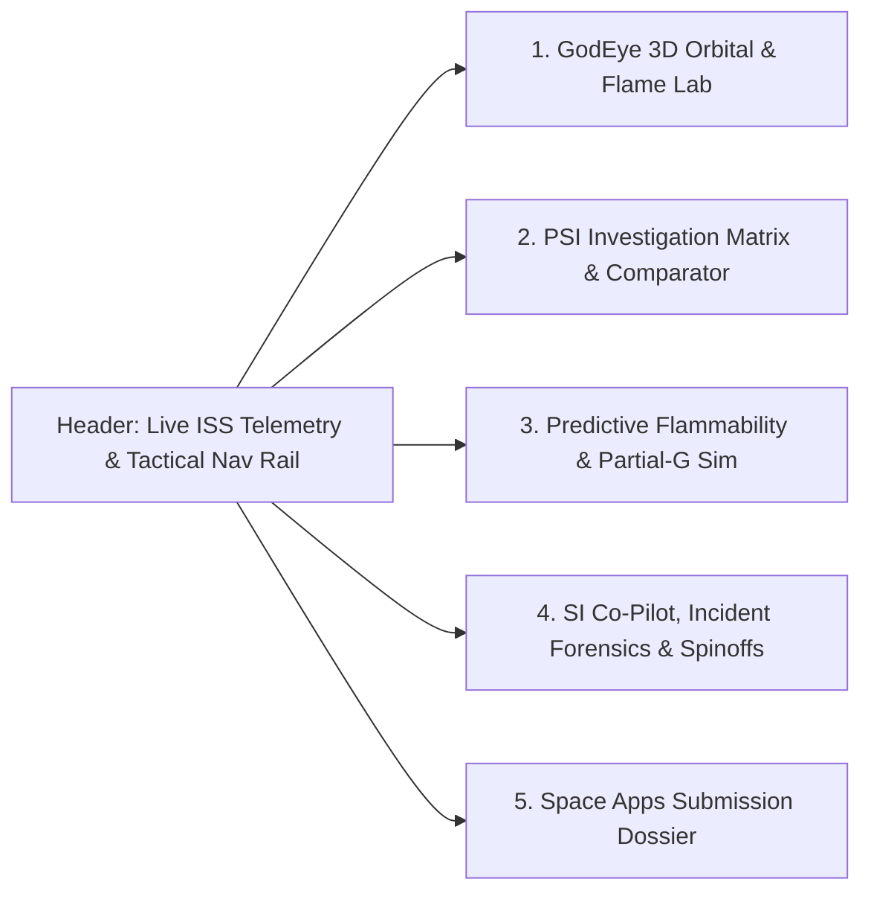

# GODEYE // PYRO-SI — Principal Design Audit & Scientific UI/UX Architecture

**Document Version:** 2.0.0-AUDIT  
**Author:** Principal Product Designer & Scientific UI/UX Architect  
**Project:** GODEYE // PYRO-SI (NASA Space Apps Challenge 2026 — *Flame in Freefall*, Team: whoami)  
**Target Repository:** `/Users/pavan/Desktop/PYRO-SI`

---

## Executive Summary

GODEYE // PYRO-SI is a scientifically rigorous platform bridging NASA's Physical Sciences Informatics (PSI) microgravity combustion research with operational fire safety for extraterrestrial human exploration (ISS, Artemis Lunar Base Camp, Gateway, Mars transit). 

While the application features deep domain knowledge and physics foundations, its current visual presentation suffers from **"Sci-Fi / Arcade Syndrome"**—an over-reliance on 1990s cyberpunk tropes (heavy neon glows, corner HUD brackets, scanline CRT overlays, pulsing animations, and the clunky `Orbitron` display font). These decorative flourishes detract from the software’s authority, degrade readability, and create visual fatigue for aerospace engineers, researchers, and NASA evaluators.

This document establishes an authoritative **Scientific Interface Architecture** benchmarking NASA Eyes on the Solar System, SpaceX Crew Dragon flight displays, Palantir Foundry, and Linear. It provides a complete design token system, component specifications, typography hierarchy, and UI layout blueprints across all five modules.

---

## 1. Comprehensive Critique of Current Implementation

### 1.1 The "Sci-Fi Arcade" Problem (Visual Noise & Clutter)
Inspection of `index.html`, `src/styles/variables.css`, and `src/styles/components/hud.css` reveals several high-distraction design choices:

1. **Decorative Corner Brackets (`.hud-panel::before`, `.hud-panel::after`)**:
   - Every card has 10px artificial neon cyan/amber corner brackets (`border-top: 2px solid var(--color-cyan-hud)`).
   - *Impact:* Creates visual clutter, breaks content alignment, and mimics an arcade video game rather than flight-certified avionics or mission-control telemetry.
2. **Scanline Overlay (`.scanline-overlay`)**:
   - A CSS repeating linear gradient simulating a cathode-ray tube (CRT) monitor with 4px alternating scanlines.
   - *Impact:* Degrades subpixel text rendering, reduces legibility of small numerical values, and signals nostalgia rather than modern aerospace precision.
3. **Hyper-Saturated Neon Palette & Glow Shadows**:
   - Variables define raw neon cyan (`#00F0FF`), glowing flame amber (`#FF6B00`), and blinding dropshadows (`0 0 16px rgba(0, 240, 255, 0.35)`).
   - Radial gradients and a 36px cyan grid pattern (`background-size: 36px 36px`) sit behind all content on the `body`.
   - *Impact:* Competes with data visualizations (Three.js globe and 2D flame physics canvas) and causes eye strain in prolonged analytical sessions.
4. **Distracting Pulse Animations (`.pulse-glow`, `animate-ping`, `animate-pulse`)**:
   - Permanent pulsing dots and badges across headers and HUD readouts.
   - *Impact:* In aerospace Human Factors Engineering (HFE) standards (NASA-STD-3001), continuous flashing is strictly reserved for Class 1 critical unacknowledged warnings. Using animation for nominal or decorative statuses numbs operator sensitivity.

### 1.2 Typographic Chaos & Legibility Failures
1. **Misuse of `Orbitron` Display Font**:
   - Configured in `variables.css` as `--font-display: 'Orbitron'`. Used for small card titles, telemetry headers, and metric labels (`font-display font-bold text-sm`).
   - *Critique:* Orbitron has wide tracking, angular cuts, and poor x-height legibility below 18px. At small sizes, numbers like `0`, `8`, and `B` or letters like `E` and `F` look indistinct.
2. **Typography Clutter & Micro-Fonts**:
   - Overuse of sub-11px text (`text-[9px]`, `text-[10px]`, `text-[11px]`) in dense uppercase monospace.
   - Mixing uppercase monospaced labels with sentence-case sans-serif body copy and stylized Orbitron titles with no coherent typographic scale.
3. **Tabular Data Without Tabular Numbers**:
   - Real-time numerical coordinates, velocities, and flame spread rates lack CSS `font-variant-numeric: tabular-nums`, leading to visual jitter and shifting column widths during updates.

### 1.3 Layout, Spacing & Container Rigidities
1. **Hardcoded Heights (`h-[520px]`) in Module 1**:
   - The Three.js globe, flame canvas, and habitat telemetry columns each have `h-[520px]`.
   - On standard laptop screens (1366x768 or 1440x900) or vertical aspect ratios, this forces awkward nested scrolling where users scroll inside cards before the page scrolls.
2. **Cramped Multi-Column Grids**:
   - In Module 1, the right-hand habitat panel packs 4 atmospheric gauges, a risk box, and a list of ranked studies into a tight 3-column span of a 12-column grid.
   - In Module 3, parameter controls and material flame spread bars are squeezed alongside a 250px chart, sacrificing readability.
3. **Arbitrary Padding & Gap Units**:
   - Random alternation between `p-2.5`, `p-3`, `p-4`, `p-5`, and inconsistent margins throughout sections.

### 1.4 Ambiguity: Ground Truth Flight Data vs. Empirical Simulation
- Currently, NASA PSI flight-verified data (BASS-II, Saffire, ACME) and empirical extrapolations (our 0.16g lunar bounding model based on E-FIELD ion forces) share identical card aesthetics and badges.
- An outside reviewer or NASA judge cannot immediately discern which numbers represent actual flight measurements versus mathematical interpolations.

---

## 2. Industry Benchmarks: Modern Aerospace & High-Stakes Analytics

| Platform | Canvas & Palette | Typography | Data Density & Hierarchy | Core Takeaway for GODEYE |
| :--- | :--- | :--- | :--- | :--- |
| **SpaceX Crew Dragon Telemetry** | Slate/charcoal `#12151A`, pitch `#0B0D10`. No decorative glows. High-contrast white (`#FFFFFF`) on dark. | Clean, highly legible Grotesk/DIN style. Monospaced tabular figures for altitude, velocity, and pressure. | Utilitarian clarity. Status colors strictly follow Warning (Red), Caution (Amber), Advisory (Cyan), Nominal (Green/White). | Strip all cosmetic sci-fi flair. Let the numbers and spatial views command attention. |
| **NASA Eyes on the Solar System** | Deep cosmic dark `#06070B`, subtle translucent surfaces. | Inter / Helvetica Neue. Crisp sans-serif with subtle tracking. | Clean astronomical viewport with floating floating telemetry badges; crisp hairline HUD elements. | The 3D Orbital Globe and Flame Chamber must be unobstructed hero elements, framed by minimal slate chrome. |
| **Palantir Foundry / Gaia** | Dark room neutral `#0F141C`, `#18202C` surface. 1px hairline borders (`rgba(255,255,255,0.08)`). | System sans-serif + JetBrains Mono for entities and calculations. | High-density tables, multi-attribute filter drawers, structured facet pills, disciplined 8px spatial grid. | Redesign Module 2 (PSI Matrix & Comparator) into a professional data workbench with clear metadata chips and table/grid views. |
| **Linear** | Charcoal/Obsidian `#08090A`, `#101114`, refined radii (`6px` / `8px`). Spring transitions. | Inter / Geist. Restrained accent colors (violet/cyan/amber) used sparingly for active states. | Exquisite micro-interactions, high keyboard ergonomics, clean keyboard shortcuts, zero UI bloat. | Deliver sleek, modern aesthetic polish without cartoonish glow effects or visual noise. |

---

## 3. Authoritative Design Direction & Design Tokens

### 3.1 Color Token Architecture

The new palette eliminates radioactive neons in favor of a **Dark Room Scientific Slate** foundation with calibrated, high-contrast semantic accents.

```css
:root {
  /* Canvas & Elevation Hierarchy */
  --canvas-void:          #06080C; /* Deepest background behind 3D canvases */
  --canvas-base:          #0B0E14; /* Default application darkroom background */
  --surface-base:         #111622; /* Primary card / panel container */
  --surface-raised:       #181F2E; /* Elevated components, headers, dropdowns */
  --surface-overlay:      #1F293D; /* Modal dialogs, floating tooltips */
  --surface-sunken:       #080B10; /* Inset metric panels, input wells */

  /* Hairline Borders & Dividers */
  --border-subtle:        rgba(255, 255, 255, 0.07);
  --border-default:       rgba(255, 255, 255, 0.12);
  --border-strong:        rgba(255, 255, 255, 0.20);
  --border-focus:         #38BDF8; /* Sky-400 */

  /* Scientific Telemetry & Accents (WCAG AAA compliant on --surface-base) */
  --accent-cyan:          #38BDF8; /* Sky-400: Primary telemetry, spatial navigation */
  --accent-cyan-subtle:   rgba(56, 189, 248, 0.10);
  --accent-amber:         #F59E0B; /* Amber-500: Thermal, combustion, caution */
  --accent-amber-subtle:  rgba(245, 158, 11, 0.10);
  --accent-emerald:       #10B981; /* Emerald-500: Nominal status, verified data */
  --accent-emerald-subtle:rgba(16, 185, 129, 0.10);
  --accent-rose:          #F43F5E; /* Rose-500: Flammability hazard, warning */
  --accent-rose-subtle:   rgba(244, 63, 94, 0.12);
  --accent-indigo:        #818CF8; /* Indigo-400: Empirical simulation, AI copilot */
  --accent-indigo-subtle: rgba(129, 140, 248, 0.10);

  /* Typography Colors */
  --text-primary:         #F8FAFC; /* Slate-50: Main headings & primary readouts */
  --text-secondary:       #94A3B8; /* Slate-400: Labels, secondary descriptions */
  --text-muted:           #64748B; /* Slate-500: Units, metadata, timestamps */
  --text-disabled:        #475569; /* Slate-600: Inactive states */

  /* Elevation & Lighting (Subtle, No Neon Bloom) */
  --shadow-sm:            0 1px 2px rgba(0, 0, 0, 0.4);
  --shadow-md:            0 4px 12px rgba(0, 0, 0, 0.5), inset 0 1px 0 rgba(255, 255, 255, 0.05);
  --shadow-lg:            0 12px 32px rgba(0, 0, 0, 0.65), inset 0 1px 0 rgba(255, 255, 255, 0.08);

  /* Radii */
  --radius-xs:            3px;
  --radius-sm:            6px;
  --radius-md:            8px;
  --radius-lg:            12px;
  --radius-pill:          9999px;
}
```

### 3.2 Typography System

1. **Retire `Orbitron` from UI components**:
   - Replace Orbitron across tabs, headings, labels, buttons, and telemetry with **Inter** or **Geist**.
   - If retained, restrict Orbitron *exclusively* to the single brand masthead text (`GODEYE`) at $\ge 20\text{px}$, with normal letter tracking.
2. **Typography Scale & Role Mapping**:

| Hierarchy Level | Font Family | Size / Line Height | Weight | Letter Spacing | CSS Utility / Target |
| :--- | :--- | :--- | :--- | :--- | :--- |
| **Masthead Brand** | Inter / Display | 18px / 24px | 800 (Extrabold) | -0.02em | Brand Title in Top Bar |
| **Module Section Title** | Inter | 18px / 24px | 700 (Bold) | -0.015em | Top of active module |
| **Card / Panel Heading** | Inter | 14px / 20px | 600 (Semibold) | -0.01em | HUD cards, comparator columns |
| **Body Text** | Inter | 13px / 20px | 400 (Regular) | 0 | Descriptions, physics explanations |
| **Micro Copy / Metadata**| Inter | 11px / 16px | 500 (Medium) | +0.02em | Secondary timestamps, DOIs |
| **Telemetry Metric** | JetBrains Mono | 18px–22px / 24px | 700 (Bold) | -0.02em (tabular) | Pressure, $O_2\%$, spread rates |
| **Parameter Label** | JetBrains Mono | 11px / 14px | 600 (Semibold) | +0.05em uppercase | Slider labels, status indicators |

3. **CSS Class for Telemetry Figures**:
```css
.telemetry-num {
  font-family: var(--font-mono);
  font-variant-numeric: tabular-nums lining-nums;
  letter-spacing: -0.02em;
}
```

---

## 4. Component System Ergonomics

### 4.1 Tactical Navigation Tabs (Header)
- **Current State:** Neon glowing cyan background pill with strong dropshadows and heavy uppercase.
- **Redesigned State:**
  - Sleek horizontal segmented rail on `--surface-base`.
  - Inactive tabs: Clean slate text (`--text-secondary`), subtle hover lightening (`text-white`, `bg-white/[0.04]`).
  - Active tab: Solid dark charcoal tile with 1px top highlight, high-contrast white text, and an illuminated 2px bottom accent bar in `--accent-cyan` or `--accent-amber`.
  - Iconography: FontAwesome Pro or Lucide micro-icons with 16px optical size, aligned precisely with baseline.

### 4.2 Parameter Sliders with Calibrated Tick Marks
- **Current State:** Plain HTML5 range with neon cyan glowing circular thumb. No visual tick marks for critical thresholds.
- **Redesigned State:**
  - Track height: 4px slate-800 (`--surface-sunken`).
  - Thumb: 14px precision disc, 2px white border, charcoal center, subtle hover ring.
  - Tick-Mark System: Micro-notches rendered on the slider rail for landmark physics points:
    - Oxygen slider: Notches at **15.0%** (Hypoxic), **20.9%** (Earth/ISS), **34.0%** (Artemis Lunar Base), **100.0%** (xEMU EVA Suit).
    - Pressure slider: Notches at **4.3 psi** (EVA Suit), **8.2 psi** (Exploration Atmosphere), **10.2 psi** (Lunar Cabin), **14.7 psi** (Sea Level).
    - Gravity slider: Notches at **0.0g** (ISS), **0.16g** (Moon), **0.38g** (Mars), **1.0g** (Earth).
  - Direct Input: Every slider pairs with an inline editable number pill, allowing precise decimal entry.

### 4.3 Scientific Data Tables & Multi-Study Comparator
- **Current State:** Cards forced into a loose grid, comparing 3 studies in horizontal scrolling cards with duplicated styling.
- **Redesigned State:**
  - Multi-Study Comparison Matrix styled as a **Structured Telemetry Table**:
    - Fixed left column: Parameter attribute names (Hardware Rack, Primary Fuel, Oxygen Range, Airflow Velocity, Detection Modality, Suppression Strategy).
    - Dynamic comparison columns (up to 4 selected investigations side-by-side).
    - Alternating row zebra fills (`rgba(255, 255, 255, 0.02)`), 1px hairline dividers.
    - Value cells highlight key differentiators (e.g., contrasting BASS-II's forced flow vs. ACME BRE's quiescent porous burner).

### 4.4 Data Provenance Badge System: Verified Flight Data vs. Empirical Simulation

Every piece of data, chart curve, and study card must display one of two standard provenance badges:

```
+-------------------------------------------------------------+
| [✓] NASA PSI FLIGHT VERIFIED                                |
| Flight Experiment: BASS-II | Rack: MSG | DOI: 10.2514/1.J05 |
+-------------------------------------------------------------+
Style: Background: rgba(16, 185, 129, 0.12), Border: rgba(16, 185, 129, 0.35)
Text: Emerald-400 (#34D399), Font: JetBrains Mono 10px uppercase
```
vs.
```
+-------------------------------------------------------------+
| [~] EMPIRICAL PREDICTIVE MODEL (UNCERTAINTY: ±14%)          |
| Extrapolated from ACME E-FIELD ion-drag & BASS-II co-flow  |
| Direct Lunar Validation Pending LUCI / FM2                 |
+-------------------------------------------------------------+
Style: Background: rgba(245, 158, 11, 0.12), Border: rgba(245, 158, 11, 0.35)
Text: Amber-400 (#FBBF24), Font: JetBrains Mono 10px uppercase
```

---

## 5. Module-by-Module Redesign Specifications



### 5.1 Module 1: GODEYE 3D Orbital & Live Flame Lab

#### Layout Architecture
- Replace fixed `h-[520px]` with responsive container `min-h-[460px] lg:h-[calc(100vh-210px)] max-h-[720px]`.
- Three-column layout balance:
  - **Left (5 cols):** GodEye 3D Orbital Habitat Globe.
  - **Center (4 cols):** Live Flame Physics Chamber (2D Canvas).
  - **Right (3 cols):** Atmospheric Profile & Active Habitat Sensor Telemetry.

#### Viewport Refinements
- **3D Globe:** Remove the fake neon circular HUD reticle in the middle of the globe (`w-64 h-64 border-cyanHud/15`). Replace with subtle coordinate grid lines rendered on the 3D sphere surface directly in Three.js. Clean floating telemetry tag in the upper-left corner with coordinates, orbital apogee/perigee, and inclination.
- **Flame Chamber:**
  - Remove amber glowing card border. Use matte slate border with a 1px amber indicator at top.
  - Regime mode buttons: Clean segmented control bar (`0.0g ISS`, `0.16g Moon`, `CFI-G Inside-Out`, `1.0g Earth`).
  - Overlay readouts: Placed in crisp, semi-translucent glass tags (`backdrop-filter: blur(8px)`, `bg-slate-900/80`) in the four corners, presenting flame geometry, peak temperature ($K$), and oxidizer transport mechanisms with tabular numbers.
- **Habitat Telemetry Column:**
  - 4 key metrics ($O_2\%$, Pressure, Gravity, Airflow) displayed as compact scientific readouts with clear units.
  - Flammability Hazard Index rendered as a clean horizontal score bar ($0\text{--}100$) with distinct severity zones: Low ($0\text{--}25$), Moderate ($26\text{--}50$), Elevated ($51\text{--}75$), Critical ($76\text{--}100$).

### 5.2 Module 2: NASA PSI Investigation Matrix & Multi-Study Comparator

#### Controls & Filtering
- Compact top control bar:
  - Search input with clear button.
  - Rack filter segmented chips: `All`, `CIR (Combustion Integrated Rack)`, `MSG (Microgravity Science Glovebox)`, `Cygnus (Saffire)`, `Lunar / Surface`.
  - Fuel type filter: `All`, `Solid Fabrics/Polymers`, `Gaseous Co-flow`, `Liquid Droplets`, `Aerosols`.
- SI Priority Weight Sliders:
  - Four compact interactive sliders (Lunar Weight, Prevention & LOI, Smoke & Dust, Suppression) presented in a collapsible calibration drawer to save vertical space.

#### Investigation Cards & Comparator
- Card Layout:
  - Top header: Study Code (`BASS-II`, `ACME CFI-G`) + Provenance Badge (`PSI VERIFIED` or `CONCEPT`).
  - Key metadata in 2x2 grid: Rack, Fuel, Data Size, Flow Range.
  - Plain English scientific takeaway (2-line clamped summary).
  - Action footer: One-click "Add to Comparator" toggle + direct link to NASA PSI repository DOI.
- Comparator View:
  - Sticky side-by-side comparison table for up to 4 selected investigations.
  - Visual delta highlighting: Rows where investigations differ (e.g. forced airflow vs quiescent, sooting vs soot-free) are subtly emphasized with amber badges.

### 5.3 Module 3: Predictive Flammability & Partial-Gravity Bounding Engine

#### Environmental Input Board
- Four precision calibrated sliders with tick marks:
  1. **$O_2$ Concentration:** $15.0\%\text{ to }100.0\%$ (Step: $0.5\%$).
  2. **Ambient Pressure:** $4.0\text{ to }15.0\text{ psi}$ / $27.6\text{ to }103.4\text{ kPa}$ (Step: $0.1\text{ psi}$).
  3. **Forced Ventilation Airflow:** $0\text{ to }55\text{ cm/s}$ (Step: $1\text{ cm/s}$).
  4. **Gravity Acceleration:** $0.00g\text{ to }1.00g$ (Step: $0.01g$).
- Quick Mission Preset Buttons: Re-styled as clean aerospace mission selector chips (`ISS Standard`, `Artemis Lunar Base`, `xEMU EVA Suit`, `ACME CFI-G Extreme`, `Earth Baseline`).

#### Output & Material Flammability Visualization
- **Top 3 KPI Tiles:**
  - Calculated Flammability Risk Index ($\%$).
  - Limiting Oxygen Index (LOI, $\%$).
  - Oxygen Partial Pressure ($ppO_2$, $\text{psi}$ / $\text{kPa}$).
- **Material Flame Spread Rate Comparison:**
  - PMMA Cast Acrylic, SIBAL Fabric, Silicone Elastomer, and Nomex HT90-40.
  - Rendered with calibrated horizontal gauge bars, including the critical extinguishing threshold indicator ($< \text{LOI}$).
- **Partial-G Bounding Curve Chart:**
  - High-resolution HTML5 Canvas with subpixel rendering (`window.devicePixelRatio`).
  - Axis lines in subtle slate-700, clean grid, clearly labeled gravity landmarks ($0g$, $0.16g$, $0.38g$, $1.0g$).
  - Current operating point marked with a distinct target reticle and live numerical tooltip.
  - Shaded confidence interval band indicating the empirical extrapolation margin before LUCI and FM2 data are integrated.

### 5.4 Module 4: SI Co-Pilot, Incident Forensics & Terrestrial Spinoffs

#### Interactive SI Query Console
- Split layout:
  - **Left Column:** Prompt suggestions + Interactive Chat/Synthesis Terminal.
  - **Right Column:** Historical Disaster Forensics + Terrestrial Fire Safety Spinoffs.
- Response Terminal:
  - Formatted scientific output with markdown support: bold headings, bulleted parameters, and explicit citation chips (`[Ref: NASA TM-2015-03-015]`, `[PSI: BASS-II]`).
  - Clear disclaimer pill: *"Synthesized from NASA PSI metadata and peer-reviewed microgravity combustion literature."*

#### Historical Spacecraft Forensics & Spinoffs
- Incident timeline cards for **Apollo 1**, **Apollo 13**, **Mir Space Station**, and **Artemis II Smoke Alarm**:
  - Left border color-coded by hazard type (Pure $O_2$ Flash Fire, Supercritical $O_2$ Electrical Wire, Solid $O_2$ Chemical Candle, Regolith Dust Nuisance Alarm).
  - Direct callout link explaining how specific PSI studies (BASS, FLEX, SAME, DAFT) prevent each exact failure mode.
- Terrestrial Spinoff Cards: Clean, icon-supported cards detailing Fine-Water-Mist Extinguishers, Dust-Discriminating Mine Detectors, and Firefighter SCBA composite tanks.

### 5.5 Module 5: Official 2026 Space Apps Submission Kit

#### Structure & Usability
- Formatted as a **Mission Briefing Dossier**:
  - Field 1: Project Name & Short Summary ($158\text{ words} / < 1500\text{ characters}$, with live character count indicator).
  - Field 2: Project Details & Technical Architecture.
  - Field 3: 7-Slide Global Award Presentation Deck Blueprint.
  - Field 4: Formatted NASA Physical Science Informatics Links & AI Disclosure.
- One-Click Clipboard Actions:
  - High-visibility `COPY FIELD` button that changes to a green checkmark state (`COPIED TO CLIPBOARD`) with spring feedback for 2 seconds upon interaction.
  - Visual character and word counters displayed below each field header to guarantee zero NASA portal truncation.

---

## 6. Implementation Action Plan & File Modifications

To transition `/Users/pavan/Desktop/PYRO-SI` to this design standard, execute the following refactoring roadmap:

1. **`src/styles/variables.css`**:
   - Replace neon color hexes with the slate/charcoal elevation tokens and WCAG AAA semantic accents.
   - Remove Orbitron from `--font-display` (or reassign to an optional masthead role).
   - Set spring animation transitions and drop-shadows without neon glows.
2. **`src/styles/components/hud.css`**:
   - Remove pseudo-element corner brackets (`.hud-panel::before`, `.hud-panel::after`).
   - Remove `.scanline-overlay` and neon glow dropshadow classes.
   - Implement clean hairline card styles (`1px solid var(--border-default)`) with subtle top highlights.
   - Refactor tab buttons to use clean segmented indicators instead of heavy cyan glows.
3. **`index.html`**:
   - Update Google Fonts import to focus on **Inter** (300, 400, 500, 600, 700) and **JetBrains Mono** (400, 500, 600, 700).
   - Remove `font-display` classes from headings and labels across all 5 modules, substituting with semibold `font-sans`.
   - Remove excessive inline glows (`shadow-[0_0_15px_rgba(...)]`) and pulsing animations (`animate-ping`, `animate-pulse`) from nominal indicators.
   - Add calibrated tick marks and unit labels to range sliders in Module 3.
4. **Canvas Chart Enhancements (`src/modules/flammability-simulator/partial-g-chart.js` & `flame-chamber.js`)**:
   - Update canvas background fills to `--canvas-void` (`#06080C`).
   - Refine curve rendering with clean anti-aliasing, subtle grid lines, and legible JetBrains Mono axis figures.
   - Add shaded empirical confidence interval bands on the partial-g continuum chart.
5. **Data Provenance Badges (`src/modules/investigation-matrix/matrix-renderer.js`)**:
   - Render the standardized `NASA PSI FLIGHT VERIFIED` vs. `EMPIRICAL PREDICTIVE MODEL` badges on all investigation cards and simulation readouts.

---

*This document serves as the design specification for the upcoming UI modernization sprint of GODEYE // PYRO-SI.*
