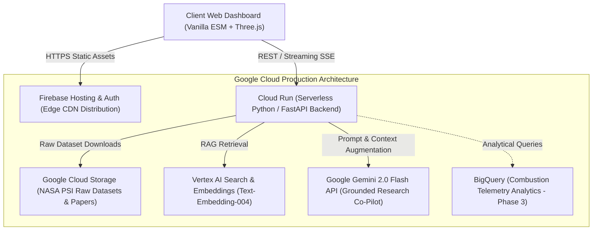
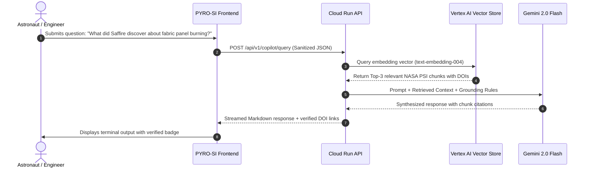

# GOOGLE TECHNOLOGY INTEGRATION PLAN

## GODEYE // PYRO-SI — Cloud Intelligence & Infrastructure Architecture

**Document Version:** 2.0.0  
**Focus:** Pragmatic Cloud Architecture for NASA PSI Scientific Intelligence  
**Compliance Rule:** Never expose API keys, service credentials, or confidential tokens in frontend source code.  

---

## 1. Architectural Strategy

Google Antigravity serves as the primary agentic development and engineering orchestrator. For production scaling, dataset ingestion, and evidence-grounded scientific intelligence, PYRO-SI leverages targeted Google Cloud Platform (GCP) and Google AI services.

Services are selected strictly based on technical necessity to avoid unnecessary architectural overhead or cloud cost accumulation.



---

## 2. Service Evaluation & Recommendation Matrix

| Service | Evaluation & Role in PYRO-SI | Integration Status | Justification |
|---|---|---|---|
| **Google Gemini API** (`gemini-2.0-flash`) | Core generative scientific co-pilot. Replaces primitive string keyword matching with natural language understanding grounded in NASA PSI papers. | **Recommended (Phase 2)** | Best-in-class reasoning speed, massive context window (up to 1M tokens), and native citation grounding capabilities. Fast enough for interactive terminal chats. |
| **Vertex AI Embeddings** (`text-embedding-004`) | Generates 768-dimensional dense vector embeddings for NASA PSI technical PDFs, conference papers, and investigation reports. | **Recommended (Phase 2)** | Enables semantic vector similarity search so users can ask natural language questions (e.g., *"How do cool flames behave after radiative quench?"*) and retrieve exact chunks from FLEX/CFI papers. |
| **Google Cloud Storage (GCS)** | Object storage bucket for authentic NASA PSI raw data packages (CSV logs, high-speed thermal videos, full-text technical reports). | **Recommended (Phase 2)** | Secure, low-cost persistence for multi-gigabyte flight datasets that cannot be checked into a Git code repository. |
| **Cloud Run** | Containerized serverless backend running Python (FastAPI). Proxies Gemini requests, securely holds `GEMINI_API_KEY`, and executes heavy data normalizations. | **Recommended (Phase 2)** | Zero server maintenance, automatic scaling down to zero when idle, and guarantees API keys are never leaked to client browsers. |
| **Firebase Hosting** | Global Edge CDN hosting for the static client web application (`index.html`, `src/`, `public/`). | **Recommended (Phase 1/2)** | Instant global deployment, free SSL certificates, and seamless zero-configuration caching for Three.js assets and client ESM modules. |
| **BigQuery** | Serverless data warehouse for querying millions of time-series telemetry rows from ISS Combustion Integrated Rack runs. | **Deferred (Phase 3)** | Only justified when raw high-frequency sensor streams (e.g. 100 Hz radiometer data across hundreds of Saffire burns) are ingested. Not required for the current 10-study metadata catalog. |

---

## 3. Gemini RAG Retrieval-Augmented Architecture

### 3.1 Retrieval Pipeline Design
To guarantee that the Research Co-Pilot never invents or hallucinates NASA findings, all responses must pass through an evidence-grounded RAG pipeline:



### 3.2 Grounded System Prompt Template

```markdown
You are the PYRO-SI Senior Scientific Combustion Specialist, supporting NASA's Space Apps 2026 Challenge.
Your role is to assist mission planners and astronauts with fire safety intelligence for extraterrestrial habitats.

CRITICAL INSTRUCTION FOR SCIENTIFIC INTEGRITY:
1. Answer the user's inquiry ONLY using the provided NASA PSI evidence chunks below.
2. If the answer cannot be verified from the provided context, state clearly: "This information is not documented in the current NASA PSI flight dataset."
3. Never fabricate experiments, test runs, burn rates, or investigator names.
4. Always cite the specific NASA investigation code (e.g., [BASS-II], [SAFFIRE-I], [ACME CFI-G]) and DOI.
5. Explicitly distinguish between measured flight data and derived empirical estimates.

CONTEXT CHUNKS:
{retrieved_chunks}

USER QUERY:
{user_query}
```

---

## 4. Security & Credential Protection

1. **No Client-Side Secrets**:
   The frontend repository contains zero API keys. `package.json`, `index.html`, and `src/app/` make calls only to relative `/api/*` endpoints hosted by the backend proxy.
2. **Secret Manager Integration**:
   On Google Cloud, secrets are stored in Google Cloud Secret Manager (`GEMINI_API_KEY`, `NASA_API_KEY`) and injected into the Cloud Run container runtime environment securely via IAM service accounts.
3. **CORS & Rate Limiting**:
   The Cloud Run FastAPI gateway enforces strict Cross-Origin Resource Sharing (CORS) whitelists, limiting API execution to verified Firebase deployment domains.
