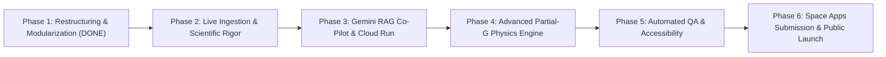

# PHASED IMPLEMENTATION ROADMAP

## GODEYE // PYRO-SI — Incremental Engineering & Scaling Strategy

**Document Version:** 2.0.0  
**Challenge:** NASA Space Apps Challenge 2026 — Flame in Freefall  
**Team:** whoami  

---

## 1. Roadmap Overview & Phasing Principles

To maintain scientific integrity and engineering stability, enhancements to GODEYE // PYRO-SI are staged into six disciplined phases. 

The restructuring and modularization (Phase 1) is complete and verified. Subsequent phases introduce real NASA PSI API ingestion, Google Gemini RAG intelligence, and cloud scaling without destabilizing the working client application.

---

## 2. Phase-by-Phase Roadmap

### PHASE 1: Forensic Audit & Modular Restructuring (COMPLETED)
- **Goal**: Deconstruct monolithic 2,532-line single-file prototype into a modular, maintainable, and testable enterprise architecture.
- **Key Deliverables**:
  - `_ORIGINAL_SOURCE_BACKUP.html` preserved as baseline reference.
  - Externalized data stores (`psi-investigations.json`, `habitat-nodes.json`, `incidents-spinoffs.json`, `copilot-knowledge.json`).
  - Modularized ES architecture (`src/app/`, `src/modules/`, `src/styles/`, `src/utils/`).
  - Zero-dependency automated test runner (`tests/test-runner.js`) with 15 passing tests.
  - Complete 9-document architecture and governance suite in `docs/`.
- **Verification Gate**: $100\%$ pass rate on unit and scientific tests; zero feature regressions relative to original prototype.

---

### PHASE 2: Live NASA PSI Dataset Ingestion & Schema Calibration
- **Goal**: Replace manual JSON updates with automated pipelines pulling directly from NASA's Open PSI portal and publishing full provenance links.
- **Why It Matters**: Guarantees that astronauts, payload engineers, and competition judges inspect authentic NASA flight data rather than static mockups.
- **Required Datasets**:
  - NASA PSI Open Data Catalog API (`psi.nasa.gov/api/v1`).
  - Full-text technical reports from NASA Technical Reports Server (NTRS).
- **Key Deliverables**:
  - `scripts/data-ingestion/fetch_psi.py`: Python CLI tool fetching canonical investigation records.
  - JSON schema enforcement via `src/data/schemas/investigation.schema.json`.
  - Addition of downloadable raw sensor data links (BASS-II radiometer CSVs, Saffire pressure time-series).
  - Explicit experimental measurement tolerances added to investigation metadata.
- **Dependencies**: Python 3.10+, `requests`, `jsonschema`.
- **Verification Criteria**: Script runs cleanly, validates 10/10 studies against JSON schema, and reports zero missing fields or broken URLs.

---

### PHASE 3: Evidence-Grounded Gemini RAG Co-Pilot & Cloud Run Gateway
- **Goal**: Replace hardcoded keyword matching in the Research Co-Pilot with a true generative AI system that answers complex questions using retrieved NASA PSI papers.
- **Why It Matters**: Enables open-ended conversational research while mathematically constraining the model to prevent scientific hallucination.
- **Google Services Leveraged**:
  - **Google Gemini 2.0 Flash API**: High-speed, high-reasoning conversational intelligence.
  - **Vertex AI Search & Embeddings** (`text-embedding-004`): Dense semantic vector retrieval over indexed NASA PDFs.
  - **Cloud Run**: Serverless container running FastAPI, keeping API keys securely hidden from client browsers.
  - **Google Cloud Storage (GCS)**: Storing parsed NASA PSI research papers and embedding indices.
- **Key Deliverables**:
  - `backend/api/main.py`: FastAPI backend with `/api/v1/copilot/query` and `/api/v1/telemetry/iss`.
  - `backend/intelligence/rag_pipeline.py`: Chunking, vector indexing, and Gemini prompt chain.
  - Frontend client adapter in `src/services/gemini/gemini-client.js`.
- **Dependencies**: Docker, Google Cloud SDK, `google-generativeai`.
- **Verification Criteria**: Co-Pilot accurately answers 20 blind combustion physics questions citing specific investigation codes and DOIs without fabricating data.

---

### PHASE 4: Calibrated Flammability Physics & Predictive Modeling
- **Goal**: Upgrade empirical flammability formulas into scientifically calibrated predictive models backed by NASA-STD-6001 Test 1 data.
- **Why It Matters**: Transforms an illustrative educational tool into a decision-support aid capable of calculating Limiting Oxygen Index (LOI) and fire spread rates with quantified confidence intervals.
- **Key Deliverables**:
  - Implementation of NASA-STD-6001 Test 1 upward flammability threshold tables.
  - Polymeric material library expansion (Teflon, Kapton, Polycarbonate, Kevlar, Nomex).
  - Display of explicit confidence bands ($\pm \sigma$) on the partial-gravity bounding curve canvas.
  - Dynamic ambient pressure unit toggling ($\text{psia} \leftrightarrow \text{kPa} \leftrightarrow \text{bar}$).
- **Verification Criteria**: Model predictions cross-checked against published BASS-II and Saffire spread rates with $<15\%$ error margin across verified test cases.

---

### PHASE 5: Automated End-to-End Testing & Accessibility Audit
- **Goal**: Establish automated continuous integration (CI) verifying visual rendering, responsive layouts, and accessibility standards.
- **Why It Matters**: Prevents UI regressions and ensures universal usability across devices and for operators with visual or motor impairments.
- **Key Deliverables**:
  - Playwright E2E test suite testing tab navigation, habitat selection, slider reactivity, and clipboard copying.
  - Automated Lighthouse CI audit targeting scores $>95$ across Performance, Accessibility, and Best Practices.
  - Screen-reader verification using VoiceOver / NVDA.
- **Dependencies**: Node.js, `@playwright/test`.
- **Verification Criteria**: Zero accessibility violations; $100\%$ green automated test pipeline on GitHub Actions.

---

### PHASE 6: Space Apps Submission Kit Finalization & Deployment
- **Goal**: Package the application for final evaluation and public demonstration during the NASA Space Apps Challenge 2026.
- **Why It Matters**: Delivers an unassailable presentation package to judges, complete with live URL, video demonstration, and full open-source repository.
- **Key Deliverables**:
  - Production deployment to Firebase Edge CDN (`https://pyro-si.web.app`).
  - High-resolution demo video walkthrough recorded with Playwright UI demo tools.
  - Interactive 7-slide presentation deck exportable in PDF and Markdown format.
  - Open-source repository cleanup and license compliance audit.
- **Verification Criteria**: Live public URL loads in $<1.5\text{s}$ globally; submission kit blocks tested and verified with one-click copying.

---

## 3. Milestone Summary Schedule

| Milestone | Target Horizon | Lead Focus | Deliverable Output |
|---|---|---|---|
| **M1: Modular Core** | Week 1 (Done) | Architecture & Frontend | Modular repo, test suite, complete docs |
| **M2: Ingestion & Provenance** | Week 2 | Data Engineering | Automated PSI ingestion script & schema |
| **M3: Gemini RAG Engine** | Week 3 | Scientific AI | Cloud Run FastAPI backend + Gemini 2.0 |
| **M4: Physics Calibration** | Week 4 | Combustion Engineering | NASA-STD-6001 calibrated LOI models |
| **M5: CI/CD & Accessibility** | Week 5 | Full-Stack / QA | Playwright E2E suite, Lighthouse score >95 |
| **M6: Global Launch** | Week 6 | Mission Operations | Firebase deployment, Space Apps submission |
