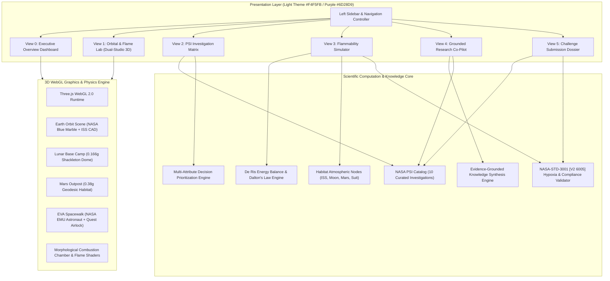

# GODEYE // PYRO-SI — Master Product Requirements Document (PRD)

**Project:** GODEYE // PYRO-SI — Spacecraft Fire Safety Intelligence Platform  
**Challenge:** NASA Space Apps Challenge 2026 — *Flame in Freefall: SI-Powered Fire Safety Insights from Microgravity Combustion Data*  
**Date:** November 15, 2026  
**Document Identifier:** NASA-PYRO-PRD-001  
**Version:** 3.0 (Phase 1 Engineering Baseline)  
**Author / Governance:** Lead Software Architect, Scientific Systems Engineer & Engineering Manager  
**Compliance Standard:** NASA SMD Open Science Guidelines, NASA-STD-3001 Rev D, NASA Open Data (CC0-1.0)

---

## 1. Executive Summary & Challenge Mandate

### 1.1. The Operational Problem
Fire aboard a crewed spacecraft or extraterrestrial habitat is a catastrophic life-safety hazard. The physics of combustion in space differs radically from terrestrial experience:
- **Terrestrial 1.0g Combustion:** Driven by gravity-induced buoyancy. Hot, low-density combustion products rise, drawing cold oxidizer into the flame base and producing the familiar turbulent, flickering teardrop flame.
- **Microgravity (~10⁻⁶g) Combustion:** Buoyancy is completely suppressed. Molecular diffusion and forced life-support ventilation drafts ($5 - 25\text{ cm/s}$) govern all oxidizer transport. Flames burn cooler, form spherical diffusion shells, generate low-temperature "cool flame" reaction zones ($500 - 800\text{ K}$), produce minimal soot incandescence, and can linger undetected in ventilation ducts.
- **Exploration Atmospheres:** Future Artemis lunar habitats and deep-space transport vehicles will operate under Exploration Atmospheres ($34\%\ \text{O}_2$ at $8.2\text{ psia}$ / $56.5\text{ kPa}$). While designed to prevent decompression sickness during extravehicular activity (EVA), the elevated oxygen concentration dramatically reduces material ignition thresholds and accelerates flame spread.
- **The Critical Partial-Gravity Data Gap:** Decades of orbital flight experiments aboard the Space Shuttle, Mir, and ISS (CIR and MSG) have generated rich datasets in microgravity ($0\text{g}$). Terrestrial laboratories have characterized $1.0\text{g}$. **However, long-duration combustion in partial gravity ($0.166\text{g}$ on the Moon, $0.38\text{g}$ on Mars) has never been recorded in orbit and does NOT exist in the NASA Physical Sciences Informatics (PSI) repository.** Aircraft parabolic flights provide only $\sim 20$ seconds of turbulent, jittered low-g conditions, insufficient for steady-state flame spread.

### 1.2. The NASA Space Apps Challenge 2026 Mandate
The NASA challenge *"Flame in Freefall"* charges teams to build a scientific intelligence (SI) platform that:
1. **Identifies** combustion investigations relevant to habitable crew environments.
2. **Extracts** data supporting predictive modelling of flammability and fire scenarios.
3. **Highlights** research informing next-generation fire-safety controls and equipment (prevention, detection, suppression).
4. **Enables** comparison and interpretation of different investigations.
5. **Supports** potential Earth applications of NASA microgravity combustion research.

### 1.3. Mission of GODEYE // PYRO-SI
**GODEYE // PYRO-SI** transforms NASA's vast, fragmented microgravity combustion archives into an interactive, transparent, evidence-grounded scientific intelligence platform. It equips astronaut crews, habitat ECLSS engineers, safety officers, and combustion researchers to discover flight investigations, compare experimental conditions, evaluate habitat atmospheric flammability, and explore theoretical partial-gravity scenarios—with strict adherence to scientific truth and transparent epistemic provenance.

---

## 2. Epistemic Principles & Scientific Integrity Rules

Every data point, calculation, chart, and visualization across the platform is bound by mandatory scientific integrity rules:

### 2.1. Six-Tier Epistemic Provenance Contract
All platform outputs must carry an explicit provenance classification:
1. **`MEASURED`**: Direct numerical telemetry recorded by flight sensors during orbital experiments (e.g., thermocouple temperatures, radiometer voltages, pressure transducer logs from Saffire-I `PSI-98` or FLEX `PSI-69`).
2. **`REPORTED`**: Stated in official NASA PSI investigation records, Technical Memorandums (TM), or peer-reviewed publications (e.g., fuel dimensions, ambient pressure, flow velocity, test date).
3. **`DERIVED`**: Deterministically calculated from verified measurements using exact physical laws (e.g., oxygen partial pressure $p\text{O}_2 = P_{\text{total}} \times Y_{\text{O}_2}$ via Dalton's Law).
4. **`MODELLED`**: Generated by documented theoretical equations, semi-empirical correlations, or mathematical proxies (e.g., classical De Ris thermal balance for flame spread). Must explicitly disclose assumptions and non-calibrated boundaries.
5. **`ILLUSTRATIVE`**: Visual, 3D, or educational renderings designed to communicate morphological structure (e.g., Three.js WebGL flame geometries, CAD module assemblies). **Explicitly NOT a Navier-Stokes Computational Fluid Dynamics (CFD) calculation.**
6. **`UNKNOWN / GAP`**: Scenarios where no verified flight or ground experimental data exists in the public domain (e.g., steady-state flame spread over lunar regolith dust under $0.166\text{g}$).

### 2.2. Negative Constraints & Prohibited Practices
- **No Fabricated Records:** Never invent NASA investigations, dataset sizes, DOI identifiers, or research conclusions.
- **No Confusion of Planned vs. Flight-Completed Research:** Planned Artemis CLPS payloads (FM2, LUCI) must be explicitly classified as `EVIDENCE GAP / PLANNED FLIGHT`, never as completed flight archives.
- **No Spurious Partial-G Flight Claims:** Never claim partial-gravity combustion flight measurements exist in PSI. ACME CFI-G (`PSI-159`) tested gaseous fuels in $0\text{g}$, and ACME E-FIELD (`PSI-22`) applied electric fields as an artificial convective proxy in $0\text{g}$.
- **No Arbitrary Accuracy or Uncertainty Claims:** Never assign uncalibrated percentage bounds (e.g., the previously excised "$\pm 14\%$ uncertainty") without formal statistical variance propagation across empirical training sets.
- **No Misrepresentation of AI Capabilities:** Never describe static keyword substring matching as a neural AI engine. Distinguish static heuristic lookup from true Retrieval-Augmented Generation (RAG).
- **No Misrepresentation of Illustrative Simulators:** Never label an interactive algebraic demonstrator as a validated DNS/CFD predictive model.

---

## 3. Product Vision, Architecture & User Personas

### 3.1. Target User Personas
```
┌─────────────────────────────────┬──────────────────────────────────────────┬──────────────────────────────────────────┐
│ User Persona                    │ Core Operational Need                    │ Primary PYRO-SI Module                   │
├─────────────────────────────────┼──────────────────────────────────────────┼──────────────────────────────────────────┤
│ Astronaut & Crew Safety Officer │ Understand non-intuitive 0g fire physics │ View 0: Home Executive Dashboard         │
│ (Artemis Mission Crew)          │ and visualize habitat risk scenarios     │ View 1: 3D Orbital & Flame Lab           │
├─────────────────────────────────┼──────────────────────────────────────────┼──────────────────────────────────────────┤
│ Habitat Life Support Engineer   │ Evaluate material flammability in EAM    │ View 3: Flammability Simulator           │
│ (ECLSS Systems Designer)        │ atmospheres with NASA-STD-3001 checks    │                                          │
├─────────────────────────────────┼──────────────────────────────────────────┼──────────────────────────────────────────┤
│ Combustion Science Researcher   │ Discover PSI datasets, compare variables,│ View 2: PSI Investigation Matrix         │
│ (NASA / Academic Investigator)  │ and identify data gaps                   │                                          │
├─────────────────────────────────┼──────────────────────────────────────────┼──────────────────────────────────────────┤
│ Mission Architecture Executive  │ Rapid retrieval of grounded historical   │ View 4: Research Co-Pilot                │
│ (Flight Director / Reviewer)    │ flight lessons and terrestrial spinoffs  │ View 5: Mission Safety Dossier           │
└─────────────────────────────────┴──────────────────────────────────────────┴──────────────────────────────────────────┘
```

### 3.2. Architectural Topology


---

## 4. Functional Product Requirements

The platform delivers capabilities organized across 14 functional areas aligned directly with the NASA challenge:

### 4.1. FR-01: NASA PSI Investigation Discovery
- **Description:** Provide a structured, transparent catalog of NASA microgravity combustion flight investigations.
- **Scope:** 10 curated investigations covering MSG, CIR, Cygnus, and Artemis CLPS platforms.
- **Requirement:** Users must be able to browse, search, and filter investigations by hardware rack, fuel phase, gravity condition, and completion status.
- **Epistemic Rule:** Investigations with verified data files in PSI are flagged with green `REPORTED [PSI]` badges; planned payloads are highlighted with amber `EVIDENCE GAP` banners.

### 4.2. FR-02: Dataset and Document Ingestion
- **Description:** Ingest, structure, and expose official NASA PSI metadata, dataset volumes, file formats, and source documentation.
- **Data Attributes:** Identifier, title, facility, release version, data volume, file count, available data products (CSV, NetCDF, MP4, ASCII tables), DOI, and official repository URL.
- **Requirement:** Direct linking to verifiable NASA PSI endpoints (`https://psi.nasa.gov/physci/repo/...`).

### 4.3. FR-03: Experimental Metadata Extraction
- **Description:** Normalize heterogeneous flight investigation parameters into an 11-field standard schema:
  1. Investigation ID (`PSI-XX` / `NASA-FM2`)
  2. Official Title
  3. Research Objective
  4. Facility & Hardware Rack
  5. Gravity Condition Actually Tested ($g$-level)
  6. Campaign Completion Status
  7. PSI Record URL & Confirmation
  8. Numerical Data File Types & Sizes
  9. Peer-Reviewed Publications & Technical Memorandums
  10. Digital Object Identifier (DOI)
  11. Forensic Verification Date & Epistemic Classification

### 4.4. FR-04: Fuel and Material Analysis
- **Description:** Categorize and display physical characteristics of fuels tested across NASA missions:
  - Solid fuels: PMMA acrylic sheets/rods (BASS-II), SIBAL fabric (75% cotton / 25% fiberglass, Saffire-I).
  - Gaseous fuels: Ethane, propane, n-butane alkane blends (ACME CFI-G).
  - Liquid fuels: Heptane, methanol, and alkane droplets (FLEX / CFI).
  - Particulate / Dust: Arizona Road Dust (ARD) and soot particulates (DAFT, SAME-R, SPICE).

### 4.5. FR-05: Oxygen, Pressure, and Airflow Condition Analysis
- **Description:** Characterize environmental boundary conditions across flight campaigns and habitat scenarios:
  - Forced ventilation airflow velocity ($0 - 40\text{ cm/s}$).
  - Ambient total pressure ($4.3 - 14.7\text{ psia}$ / $29.6 - 101.3\text{ kPa}$).
  - Oxygen concentration ($21.0\% - 100.0\%\ \text{O}_2$).
  - Atmospheric diluent effects (Nitrogen $\text{N}_2$ vs. Carbon Dioxide $\text{CO}_2$).

### 4.6. FR-06: Sensor and Measurement Extraction
- **Description:** Detail flight diagnostic instrumentation deployed across combustion chambers:
  - Thermocouple arrays (gas-phase and solid-surface thermal profiles).
  - Radiometers (narrowband and broadband radiant emission).
  - Multi-angle high-speed video camera arrays (flame front tracking, soot luminescence).
  - Gas chromatography and $\text{O}_2 / \text{CO}_2$ concentration transducers.
  - Laser absorption spectrometers and soot extinction photometers.

### 4.7. FR-07: Investigation Relevance Ranking
- **Description:** Algorithmic multi-attribute prioritization engine scoring flight investigations against user-defined mission priorities:
  - 4 independent weighting dimensions ($0 - 100\%$):
    1. Lunar Base Relevance ($0.166\text{g}$ applicability)
    2. Material Fire Prevention (solid fuel ignition & LOI)
    3. Smoke & Aerosol Detection (particle sizing & nuisance rejection)
    4. Fire Suppression & Extinguishment (water mist, $\text{CO}_2$, depressurization)
  - Processing: Normalized weighted Euclidean distance scoring capped at $99\%$.
  - Transparency: Explicitly labeled as `[USER-WEIGHTED MULTI-ATTRIBUTE PRIORITIZATION]`, never as a measurement.

### 4.8. FR-08: Cross-Investigation Comparison
- **Description:** Side-by-side parametric comparison matrix evaluating up to 3 investigations simultaneously across the 11 audited metadata parameters.
- **Requirement:** Direct visual juxtaposition of hardware facilities (CIR vs. MSG vs. Cygnus), tested fuels, and measurement products.

### 4.9. FR-09: Evidence-Backed Scientific Analytics
- **Description:** Provide rigorous physical calculations connecting environmental parameters to human safety:
  - Oxygen partial pressure: $p\text{O}_2 = (Y_{\text{O}_2} / 100) \times P_{\text{total}}$.
  - NASA-STD-3001 Compliance: Automated validation against Requirement `[V2 6005]` ($19.0 - 23.7\text{ kPa}$ nominal floor; $16.0\text{ kPa}$ contingency floor).
  - Limiting Oxygen Index (LOI): Phenomenological scaling accounting for forced flow and pressure quenching.

### 4.10. FR-10: Predictive Modelling & Theoretical Proxies
- **Description:** Real-time algebraic flammability engine based on thin-fuel thermal energy balance (De Ris, 1969):
  $$V_f \approx \frac{\sqrt{2} \cdot k_g \cdot (T_f - T_v)}{\rho_s \cdot c_s \cdot \tau \cdot (T_v - T_0)} \cdot \left(\frac{U_{\text{eff}} + U_{\text{buoy}}}{U_{\text{ref}}}\right)^{1/2}$$
  Where $U_{\text{buoy}} = 32 \times \sqrt{g}\text{ cm/s}$ and $U_{\text{eff}} = \sqrt{U_{\text{forced}}^2 + U_{\text{buoy}}^2}$.
- **Epistemic Boundary:** Output spread velocities for SIBAL, PMMA, and Silicone are labeled as `[MODELLED - DE RIS THEORETICAL PROXY]`.

### 4.11. FR-11: Research Gap Identification
- **Description:** Explicit identification of unverified combustion frontiers:
  - Complete absence of long-duration $0.166\text{g}$ and $0.38\text{g}$ flight data.
  - Flame interaction with electrostatic lunar regolith dust.
  - Low-temperature cool flame re-ignition in complex habitat duct networks.

### 4.12. FR-12: Evidence-Grounded AI Research Co-Pilot
- **Description:** Intelligent inquiry interface providing traceable, citation-backed answers to space fire safety questions.
- **Requirement:** Every synthesized answer must cite specific NASA flight records (e.g., Saffire-I `PSI-98`, BASS-II `PSI-25`, FLEX `PSI-69`), historical space incidents (Apollo 1, Mir 1997), or NASA technical standards.
- **Architectural Honesty:** Classified as a curated heuristic knowledge engine pending Phase 3 RAG integration.

### 4.13. FR-13: Earth Applications & Technology Transfer Discovery
- **Description:** Highlight terrestrial safety spinoffs originating from NASA microgravity combustion research:
  - Fine water mist fire suppression systems (halon replacement in aircraft and data centers).
  - Multi-wavelength smoke detectors (nuisance dust rejection in underground coal mining).
  - Soot reduction and clean combustion burners derived from ACME flame structure studies.

### 4.14. FR-14: Interactive 3D Environments & Combustion Visualization
- **Description:** Real-time WebGL 2.0 / Three.js 3D rendering suite delivering 6 immersive scientific experiences:
  1. Earth Orbit & Keplerian ISS flight trajectory.
  2. 3D Modular ISS Station exterior with solar array tracking.
  3. Artemis Lunar Base Camp (Shackleton crater rim, inflatable dome, vacuum lighting).
  4. Mars Surface Outpost (iron oxide dunes, geodesic habitat, salmon dust haze).
  5. EVA Spacewalk (NASA EMU spacesuit, Quest airlock, yellow handrails, red tether, Earth below).
  6. Combustion Chamber & 4 Flame Morphologies (0g spherical shell, 0.16g elongated plume, 0.38g conical plume, 1.0g flickering teardrop).

---

## 5. Non-Functional Requirements & Performance Budgets

### 5.1. Performance & Zero-Latency Standards
- **3D Polygon Budget:** Total scene geometry across any active environment must not exceed **40,000 triangles**.
- **Texture Memory Allocation:** Total GPU VRAM footprint must not exceed **15.0 MB**.
- **Frame Rate:** Consistent **60 FPS** on standard commercial desktop and laptop hardware with integrated WebGL GPUs.
- **Initial Load Time:** Sub-**1.5 seconds** on broadband networks.

### 5.2. Offline Execution & Resilience
- **Self-Contained Fallbacks:** All 3D procedural geometries must execute cleanly even if external GLB asset files fail to load.
- **Zero Heavy Backend Requirement:** Core scientific analytics, 3D visualization, and investigation matrix must operate entirely in-browser without requiring external server processes.

### 5.3. Visual Quality & UI/UX Standards
- **Theme:** Professional Light White/Lavender (`#F4F5FB`) base with Royal Purple (`#6D28D9`) primary accent.
- **Typography:** `Inter` for interfaces; `JetBrains Mono` for tabular metrics and telemetry.
- **Component States:** All interactive buttons and controls must support full 6-state lifecycle (`default`, `hover`, `active:scale(0.97)`, `focus-visible`, `disabled`, `loading`).
- **Responsive Geometry:** Seamlessly adaptive from 390px mobile viewports up to 1680px ultra-wide flight cleanroom displays.

---

## 6. Regulatory & Normative Standards Compliance

| Standard Identifier | Standard Name / Section | Platform Enforcement |
|:-------------------|:------------------------|:---------------------|
| **NASA-STD-3001 Vol 2 Rev D** | *NASA Space Flight Human-System Standard: Habitability & Environmental Health*, Section 6.1 `[V2 6005]` | Evaluates $p\text{O}_2$ nominal operational corridor ($19.0 - 23.7\text{ kPa}$ / $2.76 - 3.44\text{ psi}$) and contingency decompression floor ($16.0\text{ kPa}$ / $2.32\text{ psi}$). |
| **NASA/TP-2013-217380** | *Suit-Atmosphere Respiratory Health and Fire Safety in Exploration Environments* | Benchmarks Artemis Exploration Atmosphere ($34\%\ \text{O}_2$ at $8.2\text{ psia}$ / $56.5\text{ kPa}$). |
| **NASA SPD-41a** | *Scientific Information Policy for the Science Mission Directorate* | Enforces open science data contracts, non-fabrication of records, and transparent DOI referencing. |
| **NASA-STD-6001B** | *Flammability, Odor, Offgassing, and Compatibility Requirements and Test Procedures for Materials in Space Environments* | Upward flammability Test 1 principles applied to material spread evaluations. |
| **CC0-1.0** | *Creative Commons Universal Public Domain Dedication* | Applied to NASA PSI dataset derivatives and challenge submission kits. |

---

## 7. Phase 1 Sign-Off & Verification

This Master Product Requirements Document defines the definitive scope, functional taxonomy, scientific boundaries, and acceptance criteria for **GODEYE // PYRO-SI**. It supersedes all previous informal specifications and serves as the governing benchmark for all subsequent engineering milestones.
