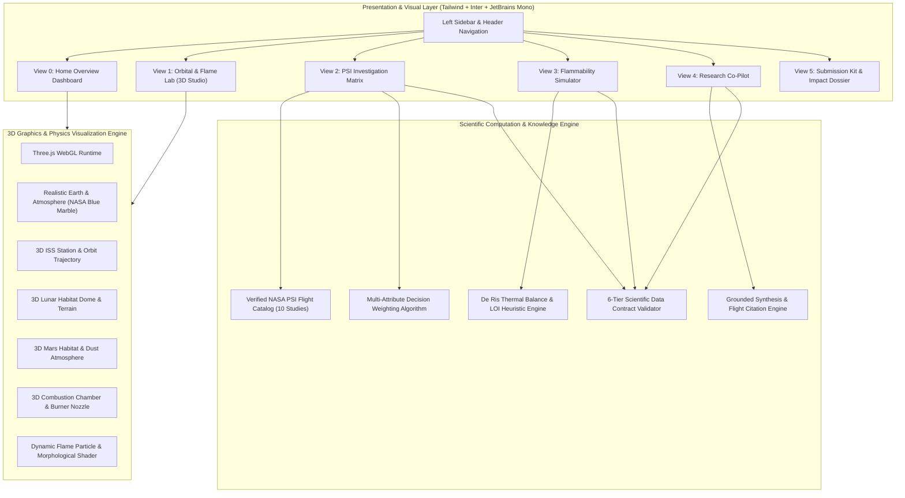

# GODEYE // PYRO-SI — Product Vision & Architecture

**Project:** GODEYE // PYRO-SI — Spacecraft Fire Safety Intelligence Platform  
**Challenge:** NASA Space Apps Challenge 2026 — *Flame in Freefall*  
**Date:** November 15, 2026  
**Document Version:** 2.1 (Scientifically Audited & Corrected Blueprint)  
**Standard:** NASA SMD Open Science & Scientific Integrity Guidelines  

---

## 1. Executive Summary & Challenge Mandate

During human space exploration, fire is an existential risk. On Earth, natural buoyant convection lifts hot combustion products away and draws fresh oxygen into the flame base, driving the familiar flickering teardrop shape. In microgravity ($\sim 10^{-6}\text{g}$), buoyancy is completely suppressed:
- Molecular diffusion and forced ventilation dominate flame transport.
- Flames burn cooler, form spherical blue diffusion shells, produce low-temperature "cool flame" reactions, and can persist unnoticed inside ventilation ducts.
- Under Exploration Atmospheres (e.g., Artemis Lunar Base: $34\%\ \text{O}_2$ at $8.2\ \text{psi}$ / $56.5\ \text{kPa}$), ignition thresholds drop and materials ignite far more readily than in standard $21\%\ \text{O}_2$ sea-level air.

Crucially, **a profound evidence gap exists regarding long-duration combustion in partial gravity ($0.166\text{g}$ on the Moon, $0.38\text{g}$ on Mars)**. Decades of orbital flight tests in the Combustion Integrated Rack (CIR) and Microgravity Science Glovebox (MSG) have tested zero buoyancy ($0\text{g}$). Terrestrial labs test $1.0\text{g}$. Theoretical hypotheses suggest that weak partial-gravity buoyant drafts may supply oxidizer without blowing out flames, but **in-situ lunar flight combustion data does not yet exist in NASA PSI**.

**GODEYE // PYRO-SI** transforms documented NASA PSI flight investigations (BASS, Saffire, FLEX, ACME, SAME-R) into a transparent, scientifically honest intelligence platform that clearly separates **flight-measured evidence**, **theoretical models**, and **critical evidence gaps** for future human exploration missions.

---

## 2. Core User Personas & Problem-Solution Matrix

```
┌─────────────────────────────────┬──────────────────────────────────────────┬──────────────────────────────────────────┐
│ User Persona                    │ Core Operational Pain Point              │ PYRO-SI Integrated Solution              │
├─────────────────────────────────┼──────────────────────────────────────────┼──────────────────────────────────────────┤
│ Astronaut & Crew Safety Officer │ Inability to visualize how fire behaves  │ Real-time 3D Orbital & Flame Lab         │
│ (e.g., Artemis Expedition Crew) │ in 0g vs. theoretical partial-g plumes   │ contrasting spherical 0g diffusion with  │
│                                 │                                          │ illustrative partial-g draft models      │
├─────────────────────────────────┼──────────────────────────────────────────┼──────────────────────────────────────────┤
│ Habitat Life Support Engineer   │ Evaluating fire risk in exploration      │ Flammability Simulator modeling De Ris   │
│ (ECLSS Systems Designer)        │ atmospheres (34% O₂, 8.2 psi) with strict│ heat balance, LOI trends, and compliance │
│                                 │ hypoxia compliance under NASA-STD-3001   │ with NASA-STD-3001 [V2 6005] limits      │
├─────────────────────────────────┼──────────────────────────────────────────┼──────────────────────────────────────────┤
│ Combustion Science Researcher   │ Fragmented NASA PSI records across       │ Searchable PSI Investigation Matrix with │
│ (NASA / Academic Investigator)  │ CIR, MSG, and Cygnus flight missions     │ 3-way side-by-side variable comparator   │
│                                 │ with unclear data file availability      │ and verified file/volume provenance      │
├─────────────────────────────────┼──────────────────────────────────────────┼──────────────────────────────────────────┤
│ Mission Architecture Executive  │ Rapid retrieval of grounded historical   │ Grounded Research Co-Pilot citing Apollo │
│ (Flight Director / Reviewer)    │ flight lessons and terrestrial spinoffs  │ 1, Mir 1997, and PSI flight datasets     │
│                                 │ without fabricated claims or numbers     │ with strict 6-tier provenance tagging    │
└─────────────────────────────────┴──────────────────────────────────────────┴──────────────────────────────────────────┘
```

---

## 3. The Six Pillars of the PYRO-SI Experience

1. **Discovery of NASA Combustion Research:** Transparent exploration of 10 flight investigations spanning CIR, MSG, Saffire, and planned Artemis CLPS missions, with explicit completion status.
2. **Synthesis of Research Findings:** Concise, evidence-grounded summaries of complex multi-gigabyte flight campaigns (solid fuel combustion, droplet burning, coflow gas flames, smoke detection).
3. **Multi-Attribute Decision Ranking:** Algorithmic ranking of flight investigations tailored to operational priorities (Lunar base relevance, material flammability, suppression, smoke sensing) using transparent user weights.
4. **Side-by-Side Experimental Comparator:** Direct cross-comparison of experimental rigs, fuel forms, tested gravity conditions, flow regimes, and sensor payloads.
5. **Interactive 3D Simulation & Environments:** Realistic 3D Earth orbit tracking, lunar and martian surface habitat visualizations, and interactive combustion chamber with illustrative morphological flame rendering.
6. **Strict Provenance & Scientific Honesty:** Enforcing the 6-tier provenance contract (`MEASURED`, `REPORTED`, `DERIVED`, `MODELLED`, `ILLUSTRATIVE`, `UNKNOWN`) across every UI component.

---

## 4. Architectural System Topology



---

## 5. Visual Identity & Brand Hierarchy

Aligned with the approved reference design (`media_1794744533852_b07836bc.jpg`):
- **Base Canvas:** `#F4F5FB` (Crisp Light White/Lavender, eliminating dark room fatigue).
- **Primary Brand Accent:** Royal Purple (`#6D28D9` / `#7C3AED`) representing deep space exploration and intelligence.
- **Card Surfaces:** `#FFFFFF` with hairline slate borders (`#E2E8F0`), $16\text{px}$ corner radii (`rounded-2xl`), and subtle elevation shadows.
- **Scientific Provenance Badges:**
  - `MEASURED / FLIGHT DATA`: Emerald Green (`#059669` / `#D1FAE5`)
  - `REPORTED RECORD`: Indigo Blue (`#4F46E5` / `#EEF2FF`)
  - `MODELLED / HEURISTIC`: Slate Neutral (`#475569` / `#F1F5F9`)
  - `EVIDENCE GAP / PLANNED`: Amber Caution (`#D97706` / `#FEF3C7`)
  - `HYPOXIA CONTINGENCY ALERT`: Crimson Alert (`#DC2626` / `#FEE2E2`)
