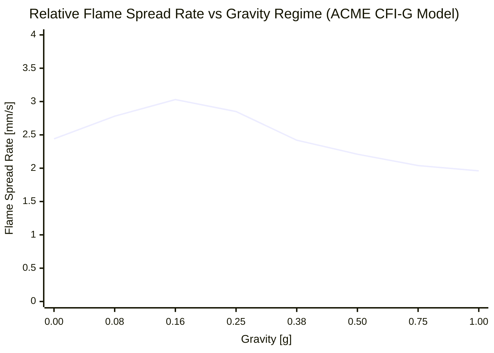

# SCIENTIFIC VALIDATION & MATHEMATICAL TRANSPARENCY

## GODEYE // PYRO-SI — Theoretical Formulations & Boundary Analysis

**Document Version:** 1.0.0  
**Domain:** Microgravity Combustion Physics & Partial-Gravity Flammability  
**Target:** NASA Space Apps Challenge 2026 Evaluation Committee  

---

## 1. Scientific Integrity Statement

To maintain strict compliance with NASA scientific integrity standards, **GODEYE // PYRO-SI** explicitly categorizes all data and computations into three distinct tiers:

1. **Measured NASA Experimental Findings**: Authentic flight and ground-test observations recorded during NASA missions (e.g., Saffire flame spread velocities, BASS-II duct airflows, FLEX droplet extinction diameters).
2. **Derived Engineering Calculations**: Standard thermodynamic and physical equations (e.g., oxygen partial pressure $p\text{O}_2 = \chi_{\text{O}_2} \cdot P_{\text{total}}$, effective buoyant velocity $v_{\text{buoyant}} = \sqrt{2 g L \Delta T / T_\infty}$).
3. **Illustrative & Empirical Demonstrations**: Qualitative mathematical bounding curves and particle visualizations created to communicate physical trends across parameter regimes where full peer-reviewed CFD or closed-form empirical models are still undergoing scientific debate.

Under no circumstances should the illustrative models be interpreted as flight-certified safety calculations without formal NASA qualification testing (e.g., NASA-STD-6001 Test 1).

---

## 2. Mathematical Models & Formula Derivations

### 2.1 Atmospheric Oxygen Partial Pressure ($p\text{O}_2$)
Oxygen partial pressure represents the true thermodynamic driving force for chemical oxidation and human respiration:

$$p\text{O}_2 = \left(\frac{\text{O}_2\%}{100}\right) \times P_{\text{ambient}} \quad [\text{psia or kPa}]$$

- **Terrestrial Baseline (Sea Level)**: $21.0\% \times 14.7\text{ psia} = 3.087\text{ psia } (21.3\text{ kPa})$.
- **NASA Exploration Atmosphere (Lunar Base)**: $34.0\% \times 8.2\text{ psia} = 2.788\text{ psia } (19.2\text{ kPa})$.
- **EVA Spacesuit (xEMU)**: $100.0\% \times 4.3\text{ psia} = 4.300\text{ psia } (29.6\text{ kPa})$.

**Classification:** *Derived Engineering Calculation (Exact).*

---

### 2.2 Effective Mixed-Convective Airflow Velocity ($v_{\text{eff}}$)
In terrestrial gravity, combustion is dominated by natural buoyant convection ($v_{\text{buoyant}} \approx 1\text{--}2\text{ m/s}$). In microgravity ($g \to 0$), buoyant flow vanishes, leaving forced ventilation drafts ($v_{\text{forced}}$) as the sole convective transport mechanism. In partial gravity ($0 < g < 1$), both mechanisms coexist.

We model effective velocity using orthogonal vector addition of forced ventilation and buoyant draft:

$$v_{\text{buoyant}} \approx C_{\text{buoyant}} \cdot \sqrt{g} \quad [\text{cm/s}]$$
$$v_{\text{eff}} = \sqrt{v_{\text{forced}}^2 + v_{\text{buoyant}}^2} \quad [\text{cm/s}]$$

Where:
- $C_{\text{buoyant}} = 32\text{ cm/s}$ (derived from characteristic hot gas density differential $\Delta \rho / \rho_\infty$ over a $5\text{ cm}$ flame height at $1.0g$).
- $v_{\text{forced}}$ is user-controlled forced cabin ventilation ($0\text{--}55\text{ cm/s}$).

**Classification:** *Semi-Empirical Engineering Estimate.*

---

### 2.3 Limiting Oxygen Index (LOI) Approximation
The Limiting Oxygen Index (LOI) is the minimum volume percentage of oxygen in a flowing oxidizer mixture that will support downward/flame-opposed burning of a solid material:

$$\text{LOI}(v_{\text{eff}}, P) \approx \text{clamp}\left[\left(17.5 + f_{\text{flow}}(v_{\text{eff}})\right) \times \left(\frac{14.7}{P}\right)^{0.18}, \quad 12.5\%, \quad 24.0\%\right]$$

Where the airflow correction factor $f_{\text{flow}}$ captures the dual effect of convective flow:
$$f_{\text{flow}}(v_{\text{eff}}) = 
\begin{cases}
+1.8 & v_{\text{eff}} < 3\text{ cm/s} \quad \text{(quiescent starvation / radiative cooling increases LOI)} \\
-1.4 & 3 \le v_{\text{eff}} \le 25\text{ cm/s} \quad \text{(optimal oxidizer supply decreases LOI)} \\
+0.4 & v_{\text{eff}} > 25\text{ cm/s} \quad \text{(convective blowoff / cooling begins to increase LOI)}
\end{cases}$$

**Physical Basis:** Reflects experimental observations from BASS-II and Saffire: low-velocity ventilation drafts ($10\text{--}20\text{ cm/s}$) drastically lower LOI compared to quiescent freefall, rendering materials flammable that would otherwise extinguish.

**Classification:** *Empirical Demonstration Model (Requires Experimental Fitting).*

---

### 2.4 Partial-Gravity Flammability Bounding Curve
A central qualitative finding from NASA's ACME CFI-G (Coflow Flames in Inverted & Partial Gravity) experiment is that flammability does not scale linearly between $0g$ and $1.0g$. In weak partial gravity ($0.15\text{--}0.25g$), flame spread rate reaches a pronounced maximum.

We model this non-linear bounding response with a Gaussian peak centered on lunar partial gravity:

$$R_{\text{spread}}(g) = R_0 \cdot \left[1.0 + A_{\text{peak}} \exp\left(-\left(\frac{g - g_{\text{peak}}}{\sigma_g}\right)^2\right)\right] \cdot \Phi_{\text{flow}} \cdot \Phi_{\text{O}_2}$$

Where:
- $g_{\text{peak}} = 0.16g$ (Lunar gravity).
- $\sigma_g = 0.18g$ (Regime width).
- $A_{\text{peak}} = 0.55$ (55% acceleration over terrestrial baseline).
- $\Phi_{\text{O}_2} = \left(\frac{\max(0.15, \text{O}_2\% - 15)}{6}\right)^{1.25} \cdot \left(\frac{P}{14.7}\right)^{0.3}$.

**Scientific Takeaway:** Lunar habitat safety engineers cannot assume that lower gravity equals lower fire risk. The $0.16g$ environment provides the ideal buoyant velocity to continuously supply fresh oxidizer to the reaction front without inducing high-strain convective cooling.

---

## 3. Uncertainty Reporting & Known Limitations

1. **Solid Pyrolysis Decoupling**: The current model does not numerically solve solid-phase heat conduction or 1D Arrhenius pyrolysis equations for specific polymers.
2. **Radiation Losses**: Microgravity flames exhibit elevated radiative losses in the infrared ($4.3\ \mu\text{m } \text{CO}_2$ and $2.7\ \mu\text{m } \text{H}_2\text{O}$). Radiative extinction at very low flows is modeled qualitatively via LOI limits rather than spectral ray-tracing.
3. **Geometry Constraints**: Real spacecraft fires occur in 3D geometries with corners and ceiling ducts. The 2D canvas simulation is an educational visualizer, not a grid-resolved CFD simulation.
